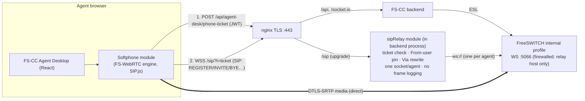
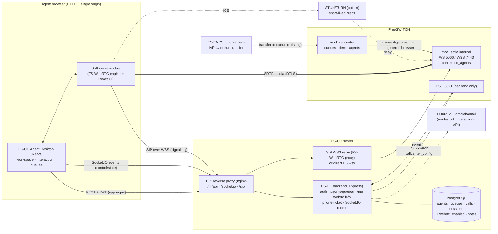

# FS-CC Agent Desktop + WebRTC Phone: Feasibility Audit (Phase 0)

| | |
|---|---|
| Date | 2026-11-07 |
| Mode | **Read-only.** This file is the only artifact created. No source, configuration, `.env`, database, Git, dependency or service was changed. The DEV server was not contacted. |
| Location choice | FS-CC owns the Agent Desktop, so the report lives in `fs-cc/docs/enterprise/`, a new sub-folder of the existing `fs-cc/docs`. It was deliberately **not** placed in `fs-enrs/docs/enterprise/`, which keeps FS-ENRS untouched. |
| Evidence labels | **[V]** verified by a command or file read on this laptop · **[S]** source-code observation · **[A]** architectural assumption · **[R]** recommendation · **[RT]** needs a future isolated runtime test · **[U]** user-provided validation |

---

## 1. Executive summary

- **Migration.**
  - **FS-CC** and **FS-WebRTC** are *verified complete based on available local evidence*: clean trees, refs consistent with their last-fetched remotes, connectivity check passes.
  - **FS-ENRS** is *partially verified*: history is intact, but 5 uncommitted/untracked documentation files exist **only on this laptop**.
  - No repository can be compared against the old laptop or GitHub without fetching, so "complete" means *complete relative to the last fetch*.
  - Two stale clones exist on the laptop: `Documents\fs-cp` and `Documents\fs-cp\fs-enrs`. The second has **15 unpushed commits and 202 uncommitted changes**. Someone must decide what to do with them.
- **Key architectural finding [S].**
  - FS-CC already routes queue calls to agents through FreeSWITCH `mod_callcenter`. For agents of type `internal`, the contact string is `{sip_cid_type=pid}user/<extension>@<FS_SIP_DOMAIN>` (`backend/controllers/agentsController.js` `buildContact`).
  - FreeSWITCH resolves `user/…` to **whatever device is registered** for that extension. A browser phone that registers as the agent's extension therefore receives queue calls **with no change to FS-CC's call distribution logic**.
  - This is the single most important enabler for the integration.
- **The Agent Desktop has no telephony today [V].** There are no SIP, WebRTC or media APIs anywhere in FS-CC. It shows status from ESL and polls REST every 3 seconds.
- **FS-CC has no call control [S].** There are no `uuid_transfer`, `uuid_hold`, `originate` or `uuid_kill` commands. Hold, mute, DTMF and hangup would come from the browser phone (SIP). Transfer needs new work.
- **The WebRTC phone is suitable and does not need a rewrite.**
  - Its engine (`src/sip`, `src/services`, `src/audio`) is framework-independent TypeScript behind one facade, `PhoneService`.
  - Only its vanilla-DOM UI must be re-expressed as React components.
- **SIP authentication (§10B, accepted 2026-11-07):** the **agent enters their own SIP password** in the integrated phone panel, against a server-fixed extension. The **existing FreeSWITCH directory stays the credential source**. FS-CC stores, generates, returns and rotates **no** SIP passwords in release 1. This **supersedes** every earlier mention of backend-managed credentials (`sip-credentials` endpoint, encrypted SIP secret, rotation). The FS-WebRTC engine already accepts credentials programmatically and keeps them in memory only, so there is **no security regression**.
- **Admin-controlled telephony (§10A):**
  - One deployment mixes PBX agents (Avaya, Cisco, gateway) with WebRTC agents.
  - The admin assigns WebRTC per agent through one additive Boolean, `webrtc_enabled`, combined with the existing `agent_type`. No `telephony_mode` field is needed.
  - `WEBRTC_ENABLED` is the master switch.
  - PBX agents' contacts and desktop behaviour are unchanged.
  - Rule: one extension, one device.
  - The server refuses Available for an unregistered WebRTC agent.
- **Recommended architecture: Option D, a unified Agent Desktop**, built by moving the phone engine into FS-CC as an isolated feature module. Option B (a shared package) is the later extraction path once FS-ENRS or a second consumer needs it.
- **Main gaps that block a production rollout. The integration design itself is not blocked.**
  1. **SIP credential delivery.** The browser must hold the agent's SIP password; there is no secure backend endpoint for it yet.
  2. *(Withdrawn on 2026-11-07, owner clarification.)* FS-CC being single-deployment is **intentional**. Multi-tenancy is **OUT OF CURRENT SCOPE (future release)** and is not a gap (§16).
  3. **Socket.IO broadcasts every call and agent event to any connected client, including unauthenticated ones** (`backend/services/socketService.js`).
  4. **Agent PIN login has no rate limiting**, and there are no `helmet` security headers.
  5. **TLS/WSS is not set up** on the FS-CC Agent Desktop, which is served over plain HTTP. WebRTC requires HTTPS.
- **Final recommendation: CONDITIONAL GO** (see §23).

---

## 2. Development laptop inventory [V]

| Item | Value |
|---|---|
| OS | Windows 10 Pro 10.0.19045, AMD64 |
| CPU | Intel Core i7-4650U @ 1.70 GHz (2C/4T) |
| RAM | 7.9 GB total; about 2 GB free during the audit. **Constraint:** running 3 Vite dev servers plus browsers will be tight. |
| Disk C: | 398 GB free |
| Node.js / npm | v26.13.0 / 11.20.0 at `C:\Program Files\nodejs`. Not on the agent shell's PATH (the PATH was stale); a new terminal should resolve it. |
| Git | 2.56.0.windows.4. **System `core.autocrlf=true`** (see §4.3) |
| Python | Not installed (only the Store alias). FS-ENRS `services/piper` (Python TTS) cannot run locally. |
| Docker / Compose | Not installed |
| FreeSWITCH / fs_cli | Not installed locally (lab server 192.168.1.133 is out of scope) |
| PostgreSQL / Redis / PM2 | Not installed |
| Browsers | Chrome 157.0.8103.38 · Edge 156.0.4314.58 · Firefox 159.0.1 |
| Other | mkcert 1.4.4 and a local CA, from the earlier WebRTC POC |

**What this means:** builds, lints and unit tests are possible locally **[RT]**. Running FS-CC or FS-ENRS end to end locally is **not** possible: they need Postgres, ESL and, for ENRS, Redis.

---

## 3. Repository inventory [V]

| Item | FS-CC | FS-ENRS | WebRTC |
|---|---|---|---|
| Actual path | `C:\Users\naresh\Documents\fs-cc` | `C:\Users\naresh\Documents\fs-enrs` | `C:\Users\naresh\Documents\fs-webrtc` |
| Git repository | yes | yes | yes |
| Current branch | `main` | `fix/tenant-unification` | `main` |
| Latest commit | `f560dd7d` 2026-10-14 "fs-cc UI improvement" | `6f4aa5d` 2026-11-06 "fix(enrs): prevent false international mobile identity matches" | `23ab1ce` 2026-11-07 "Docs: HOW_IT_WORKS explainer…" |
| Commits on HEAD | 81 | 295 | 4 |
| Tracked files | 188 | 739 | 66 |
| Working tree | clean | 1 staged (`docs/enterprise/EMERGENCY_CONTACTS_EXCEL_TEMPLATE_AUDIT.md`, +151), 1 modified (`docs/enterprise/MOBILE_IDENTITY_SCOPE_REVIEW.md`, +8/−2) | clean |
| Untracked | none | `.claude/settings.local.json`, `docs/enterprise/DEV_MIGRATION_051_{DEPLOYMENT_REPORT,FINAL_COMPATIBILITY_REVIEW,READINESS}.md` | none |
| Branches | `main`; `feature/ui-modernization` (0 unique commits; `main` is 60 ahead, so it is stale and fully merged) | `main`, `fix/tenant-unification`, `feature/media-reporting-hardening`, `media-safety-remediation` (all also on origin) | `main` |
| Tags / stash | none / none | none / none | none / none |
| Remote | `github.com/nareshrock1992-arch/fs-cc.git` | `…/fs-enrs.git` | `…/FS-WEBRTC.git` |
| Ahead/behind (last fetch) | 0/0 | 0/0 | 0/0 |
| Submodules / LFS | none / none | none / none | none / none |
| Package manager | npm. Lockfiles exist for backend and frontend; **agent-desktop has no `package-lock.json`** | npm (lockfiles) | npm (exact pins plus lockfile) |
| Framework | backend: Express 4, socket.io 4, pg, modesl, jsonwebtoken, bcryptjs · frontend (admin): React 18, Vite 5, Tailwind 3, recharts, react-router 6 · agent-desktop: React 18, **Vite 6**, Tailwind 3, socket.io-client, lucide-react | backend: Express 4, pg, ioredis, modesl, zod, helmet, express-rate-limit, prom-client · frontend: React 18, Vite 5, Tailwind 3, zustand · Lua scripts · Python Piper TTS service | vanilla TypeScript 6.0.3, Vite 8.3.6, SIP.js 0.21.2, Node `ws` 8.22.1 proxy, Vitest 5, ESLint 10 |
| Runtime requirement | none declared (no `engines`, no `.nvmrc`) | backend `node >=20` | Node ≥ 22 (documented) |

### WebRTC phone classification [S]

The phone is a **combination**: a standalone frontend/backend application whose frontend is a **FreeSWITCH-connected SIP/WebRTC client**.

| Classification | Applies? |
|---|---|
| Standalone React application | **No.** It is vanilla TypeScript with imperative DOM. |
| Reusable React component | **No.** There is no React at all. |
| Standalone frontend/backend application | **Yes**: SPA plus `server/server.mjs`, which serves the files and runs a WSS→WS proxy. |
| Frontend with its own signalling service | **No.** SIP is the signalling and FreeSWITCH is the signalling server. The Node proxy only relays frames and rewrites the `Via` transport. |
| FreeSWITCH-connected SIP/WebRTC client | **Yes**: SIP.js `UserAgent` and `Registerer` register as a directory user. Media is DTLS-SRTP directly to FreeSWITCH. |

---

## 4. Migration integrity findings

### 4.1 Evidence collected [V]

- `git fsck --connectivity-only` exits 0 for FS-CC and FS-ENRS: no missing objects reachable from any ref. FS-WebRTC is loose objects only and was freshly created on this laptop.
- `git ls-files --deleted` is 0 in all three: no tracked file is missing from the working tree.
- Local branches match their `origin/*` tracking refs, with 0 ahead and 0 behind. Remote refs reflect **the last fetch on the old laptop**, not GitHub today.
- The reflogs show continuous recent history, for example FS-ENRS commits on 2026-11-05 and 11-06. Copying preserved the reflog, which is good evidence that `.git` was copied whole.
- Ignored but present (non-secret summary):
  - FS-CC: `.env`, `backend/.env`, `frontend/.env`, `agent-desktop/.env`, `node_modules/` ×3, `dist/` ×2.
  - FS-ENRS: `backend/.env`, `frontend/.env`, `node_modules/` ×2, `services/piper/.venv/`, `__pycache__`.
  - WebRTC: `certs/*.pem` (TLS keys; expected to be ignored), `dist/`, `node_modules/`.

### 4.2 Concerns and observations

| # | Repo | Finding | Risk | Recommendation |
|---|---|---|---|---|
| M1 | FS-CC, FS-ENRS | Orphan pack `.idx`/`.rev` files without a `.pack` (FS-CC 5, FS-ENRS 23) | Low. The connectivity check passes, so no data is lost; Git prints warnings. | Leave it. A later `git gc`, run only with approval, removes them. |
| M2 | FS-ENRS | 2 staged/modified and 3 untracked docs exist only on this laptop | Medium: work is lost if the laptop fails | Commit and push them, with approval |
| M3 | Laptop | `Documents\fs-cp\fs-enrs`: 15 unpushed commits (`cea22e5`, 2026-08-09) and 202 uncommitted changes; `Documents\fs-cp`: 202 uncommitted changes, including an **older copy of `fs-cc/agent-desktop`** | Medium: easy to edit the wrong copy, and possibly unique old work | Owner to decide: archive or diff. Do not develop there. |
| M4 | Laptop | **System `core.autocrlf=true`.** Git already warns that LF files in FS-ENRS will become CRLF "the next time Git touches it". | **High for deployment:** CRLF breaks `.sh` and Lua files on Linux. FS-WebRTC is protected by `autocrlf=false` plus `.gitattributes`. | Add per-repo `core.autocrlf=false` and/or a `.gitattributes` to FS-CC and FS-ENRS before any commit from this laptop (with approval). |
| M5 | FS-CC | Old absolute paths: `DEPLOYMENT.md`; `ecosystem.config.js` hardcodes `/opt/freeswitch-ui/fs-cc/...` (server path, which is expected) | Low | Documentation only |
| M6 | FS-ENRS | Old Windows user paths in `docs/enterprise/EMERGENCY_CONTACTS_EXCEL_TEMPLATE_AUDIT.md` and `docs/tenant-unification/PROGRESS.md` | Low (documents only) | None needed |
| M7 | FS-ENRS | A stray empty directory `backend;C` exists | Cosmetic. It was likely a mistyped Windows path command. | Remove later, with approval |
| M8 | FS-CC | `agent-desktop` has no lockfile, so a fresh install can resolve different versions | Medium (reproducibility) | Generate and commit a lockfile in Phase 2 |
| M9 | all | `node_modules` were copied from the old laptop; Node 26 here vs. unknown there | Low to medium; affects native modules only **[RT]** | Do a clean `npm ci` in a disposable copy before trusting builds |
| M10 | FS-CC | Root `.env` lacks `FS_SIP_DOMAIN`, which `.env.example` and `backend/.env` define | Low for local use; internal agent contacts cannot be built without it | Note for configuration design |

### 4.3 Conclusion

| Repository | Assessment | Basis / limitation |
|---|---|---|
| FS-CC | **Verified complete based on available local evidence** | Clean tree, connectivity OK, refs equal to last-fetched origin. Cannot prove the old laptop held nothing newer. |
| FS-ENRS | **Partially verified** | History intact, but there is local-only uncommitted work (M2) and a stale divergent clone (M3) |
| WebRTC | **Verified complete based on available local evidence** | Created on this laptop. HEAD `23ab1ce` equals `origin/main`, which was pushed earlier in this project. |

---

## 5. FS-CC architecture assessment

### 5.1 Backend [S]

- **Entry point:** `backend/server.js` mounts these routes:
  - **Public, agent-JWT:** `/api/agent-desk`.
  - **Public:** `/api/auth`.
  - **Behind `requireAuth`:** everything else under `/api/*`: `users`, `agents`, `queues`, `calls`, `stats`, `reports`, `break-codes`.

  It has `cors` and `morgan`. There is **no `helmet` and no rate limiting**.
- **Configuration:** `backend/config/index.js` is the single source of truth.
  - `dotenv` loads the variables, with defaults.
  - Startup refuses to run without a valid `BUSINESS_TIMEZONE`.
  - In production, startup refuses to run if `JWT_SECRET` is the default.
  - The defaults include `FS_ESL_PASSWORD='ClueCon'` and `DB_PASSWORD='changeme'`.
- **Authentication** (`middleware/auth.js`):
  - **Admin UI:** JWT carrying `role` and `permissions`.
  - **Agent Desktop:** a separate login, `POST /api/agent-desk/login` with `agent_id` and `pin` (bcrypt). It returns a 12-hour JWT `{agentId, fullName, role:'agent'}`, and `requireAgentAuth` enforces `role==='agent'`.
- **Roles:** `admin`, `supervisor`, and permissions such as `view_caller_id`. `requireSupervisor` and `hasPermission` exist.
- **Data model** (`db/schema.sql` plus migrations 001–011):
  - `queues` and `agents`. `agents` has `agent_id`, `avaya_extension`, `contact`, `agent_type` (`internal`|`gateway`), `fs_agent_type` (`callback`|`uuid-standby`), status/state, timers, `pin_hash` and break fields.
  - `agent_tiers`, `agent_state_log`, `agent_sessions`, `agent_state_events`, `calls` (with `cid_name` and `ivr_path`), `break_codes`, and `user_permissions`.
  - **No tenant or organisation column anywhere.**
- **ESL** (`services/eslService.js`, 1,120 lines):
  - Holds one `modesl` connection with reconnect.
  - Subscribes to `CHANNEL_*` and the `callcenter::info` CUSTOM events.
  - Normalises them into `ccEvents`: `agent:status`, `agent:state`, `call:enqueued`, `call:abandoned`, `call:bridged`, `call:bridge-end`, `agent:offering`, `agent:no-answer`, `channel:*`, and `prequeue:*`.
  - The `cc` helper wraps `callcenter_config agent|queue|tier …`.
  - `pushToFreeSWITCH()` re-syncs database state into `mod_callcenter` on connect.
- **Real-time** (`services/socketService.js`):
  - Socket.IO **broadcasts all `BROADCAST_EVENTS` to every client**. Agents additionally join room `agent:<id>` through `agent:authenticate`, and supervisors join `supervisors`; only `prequeue:*` is room-restricted.
  - **Security issue:** connections are not authenticated, so any client that can reach the backend sees all call and agent events, including ANI.
- **Queue configuration:** `utils/queueXml.js` generates `callcenter.conf.xml`. It writes the file only if `FS_CONF_PATH` is set.

### 5.2 Frontends [S]

- **Admin UI** (`frontend/`): React Router pages for Dashboard, Agents, Queues, LiveAgents, LiveCalls, LiveOperations, QueueStats, Reports, BreakCodes and UserManagement. It has a basic component library (`KpiCard`, `Panel`, `Modal`, `StatusBadge`, `StatusLamp`) and `UI_DESIGN_SYSTEM.md`.
- **Agent Desktop** (`agent-desktop/`, 19 source files):
  - **App structure:** `App.jsx` switches between `Login` and `Dashboard`.
  - **Auth:** `useAgentAuth` stores **the JWT and agent info in `localStorage`**.
  - **Data:** `Dashboard.jsx` polls queues every 3 s, performance every 30 s, and calls every 3 s, and also listens on the socket.
  - **Components:** `StatusControls` (Available / On Break with break codes / Logged Out), `LiveCallPanel` (display only), `CallHistory`, `BreakHistory`, `QueueCard`, `PerformanceCard`, `EslBadge` and `ThemeToggle`.
  - **API:** `api/client.js` uses `VITE_API_URL`, falling back to `/api`. `api/socket.js` uses the same origin plus `VITE_SOCKET_PATH`.
  - There is no state library.
- **Hosting:**
  - **Docker:** nginx on port 80, proxying `/api` and `/socket.io`.
  - **PM2** (`ecosystem.config.js`): runs **`npm run dev` (Vite dev servers) on ports 8000 and 8080**, so the DEV server serves unbuilt dev bundles over plain HTTP.

### 5.3 FreeSWITCH feature classification

| Capability | Status | Evidence |
|---|---|---|
| SIP registrations | **Not implemented** in FS-CC; handled by FreeSWITCH and the directory | no `sofia status` or registration logic |
| Agent extensions | **Implemented** | `agents.avaya_extension`; `buildContact` for internal/gateway |
| Inbound calls to queues | **Implemented** (by FreeSWITCH dialplan, `callcenter` app, IVR); FS-CC observes them | ESL `callcenter::info` handling |
| Outbound calls | **Not implemented** | no `originate` |
| Call bridging | **Implemented by mod_callcenter**; observed through `call:bridged` | eslService |
| Call transfer | **Not implemented** | no `uuid_transfer` |
| Hold / resume | **Not implemented** | — |
| Call termination | **Not implemented** in FS-CC (no `uuid_kill`); the agent hangs up on the phone | — |
| Queue distribution | **Implemented** (mod_callcenter strategies, tiers) | `queueXml.js`, `cc.tier*` |
| Agent login/logout | **Implemented** (desk login plus `Logged Out` status) | `agentDeskController` |
| Available / Break | **Implemented**, with break codes | `VALID_STATUSES` |
| Wrap-up | **Partially implemented**: `wrap_up_time` passed to mod_callcenter; no wrap-up UI or disposition | schema, `pushToFreeSWITCH` |
| Busy state | **Implemented** through the mod_callcenter state (`In a queue call`) | events |
| Call events | **Implemented** | `ccEvents` |
| CDR | **Partially implemented**: FS-CC builds its own `calls` table from events; FreeSWITCH CDR modules are not used | `migrate_cdr_views.sql` |
| Recordings | **Unable to determine** from source: `queues.record_calls` exists, but no recording path or playback was found | — |
| Supervisor | **Partially implemented**: live views, pre-queue monitor; no listen, whisper or barge | — |

### 5.4 Source of truth [S]

- **Agent status (Available / On Break / Logged Out):** the FS-CC **database** is written first by the desk. ESL `callcenter_config agent set status` is best effort (`try { … } catch {}` in `agentSetStatus`), and `pushToFreeSWITCH` re-applies the database values on reconnect. In effect, **the database is authoritative for configuration and status**.
- **Agent state** (Waiting / Receiving / In a queue call): **FreeSWITCH `mod_callcenter`**, reflected into the database through events.
- **Call state:** **FreeSWITCH**, reflected into `calls` through events.
- **Consequence for WebRTC:** the browser phone's own call state (SIP dialog) becomes a **third** view. It must be reconciled with, not replace, the mod_callcenter and ESL state (§10, §20 Phase 6).

---

## 6. FS-ENRS architecture assessment (impact-focused) [S]

- **Backend:** Express with zod, helmet and rate limiting; a logger; a Redis-backed config validator (`src/infrastructure/config/validator.js`). It is **multi-tenant** (`tenant_id` appears 964 times in `backend/src`, with dedicated isolation tests). It has a separate JWT scheme (`JWT_ACCESS_SECRET`/`JWT_REFRESH_SECRET`), an internal API key, Piper TTS, Lua and IVR generation, and deployment through `reloadxml`.
- **Shared FreeSWITCH:** ENRS writes dialplan, gateway and directory XML and triggers `reloadxml`, and `sofia profile external rescan` for gateways (`services/gatewayDeployment.js`). It also has a **super-admin reload endpoint**.
- **Coupling with FS-CC:** ENRS's IVR "queue eligibility" (`eslService.js` around line 2512, and `nodeTypes/registry.js`) reads `callcenter_config queue|agent|tier list`. It decides whether an FS-CC queue can answer **from agent status and state alone**, and then transfers the call into the queue.
  - **Implication:** if an agent is set Available while the browser phone is **not registered**, ENRS will consider the queue eligible but the call will ring nowhere.
  - So WebRTC registration health must be reflected in mod_callcenter agent status (§11, rule BC-3).
- **Shared tooling:** `fs-enrs/fs-dev-all.sh` starts and stops **both** FS-CC and FS-ENRS, using `pkill -f vite`. Any new FS-CC process must not be managed by editing that script (governance).
- **Separation:** ENRS uses its own database and JWT; no shared authentication with FS-CC was found.

---

## 7. Independent WebRTC architecture assessment [S]

- **Library:** SIP.js 0.21.2 in TypeScript (strict). There is no React.
- **Module map:**

  | Module | Contents |
  |---|---|
  | `src/sip/sip-client.ts` | UserAgent, Registerer, transport keep-alive, redacting log connector |
  | `src/sip/call-session.ts` | mute, hold re-INVITE, DTMF over RTP with an INFO fallback, `replaceTrack` |
  | `src/services/phone-service.ts` | `PhoneService` facade |
  | `src/services/call-state.ts` | pure reducer |
  | `src/services/reconnect.ts` | back-off scheduler |
  | `src/services/store.ts` | observable store |
  | `src/audio/*` | devices, remote audio with autoplay unlock and `setSinkId`, Web Audio ringtone |
  | `src/utils/*` | validation, redacting logger |
  | `src/components`, `src/pages` | vanilla DOM UI |
  | `server/*` | HTTPS plus WSS→WS proxy with a `Via` rewrite, CSP, Origin check, sub-protocol check |

- **Connection model:**
  - **Signalling:** browser → `wss://<host>:8443/sip` (same origin) → proxy → `ws://FreeSWITCH:5066`.
  - **Media:** browser ⇄ FreeSWITCH directly, DTLS-SRTP over UDP 16384–32768, OPUS.
- **Configuration:** `src/config/config.ts` derives the WSS URL from the page origin. Server settings are environment variables: `FSW_BIND`, `FSW_PORT`, the certificate paths, `FSW_SIP_WS_UPSTREAM`, and `DEV_SIP_WS_UPSTREAM` for Vite. **There are no secrets in the bundle.**
- **Authentication:** the user types the extension and SIP password, which are held **in memory only**. 401, 403 and 407 do not trigger retries.
- **Logging:** a redacting logger; SIP traces are redacted.
- **Validation:**
  - **[U]** The owner verified all features with two browsers on 2026-11-07.
  - **[V]** 71 unit tests, smoke tests 8/8, and headless REGISTER 200 and 403 were executed earlier in this project.

### 7.1 Security [S]

| Topic | Observation |
|---|---|
| SIP credential exposure | The browser necessarily holds its SIP password. It is never stored. FS-CC integration must not change "never persisted", and should **remove the need for agents to type it** (§13). |
| WSS / HTTPS | Both required; a mkcert lab CA is used today. Production needs a publicly trusted or enterprise-CA certificate. |
| Session | There is no app session: SIP registration *is* the session. |
| CORS / CSP | Strict CSP with `connect-src` to self; same-Origin check on the WS upgrade |
| WebSocket | Path `/sip`, `sip` sub-protocol, connection cap |
| Tenant isolation | Not applicable (single lab context `webrtc_lab`). Isolation today comes from the **FreeSWITCH dialplan context**, which is the right layer. |
| Call authorization | Enforced by FreeSWITCH (`user_context`, empty `toll_allow`) |
| Rate limiting | No application rate limit. FreeSWITCH challenges every REGISTER; repeated failures are not throttled. **[R]** Add `fail2ban` or the sofia `auth-calls`/ACL measures in production. |

### 7.2 Integrate as a module, or keep it separate?

- **Module integration is feasible without rewriting the engine.**
  - `PhoneService` exposes a store plus a set of commands: `login`, `logout`, `dial`, `answer`, `reject`, `busy`, `hangup`, `toggleMute`, `toggleHold`, `sendDtmf`, `selectInput`, `selectOutput`, `unlockAudio`.
  - A React hook (`usePhone()` built on `useSyncExternalStore`) can wrap it in about 100 lines.
  - What must be re-implemented is **the UI only**, as React and Tailwind components that match the FS-CC design system.
- **What stays separate:** the WSS→WS proxy is infrastructure, not UI. Keep it as its own small service, or replace it with direct WSS to FreeSWITCH (§8, FreeSWITCH changes).

---

## 8. WebRTC functionality matrix

| Feature | Status | Notes |
|---|---|---|
| SIP over WSS | Implemented **[S][U]** | through the proxy |
| Registration / renewal | Implemented **[S][U]** | SIP.js Registerer auto-refresh |
| SIP digest authentication | Implemented **[S][V]** | 200 OK / 403 verified |
| FreeSWITCH profile compatibility | Implemented **[U]** | internal profile ws :5066 plus `apply-candidate-acl=localnet.auto` |
| ICE | Implemented, **LAN host candidates only** **[S]** | `iceServers: []` |
| STUN | **Missing** | not configurable today |
| TURN | **Missing** | required for remote, NAT'd or home agents |
| DTLS-SRTP | Implemented **[U]** | |
| Codecs | OPUS negotiated **[U]**; no app-level preference | |
| Mic permission / speaker selection | Implemented **[S][U]** | `setSinkId` is unavailable in some browsers |
| Incoming / outgoing / answer / reject / busy (486) / hangup | Implemented **[S][U]** | |
| Hold / resume, mute, DTMF (RFC 2833, INFO fallback) | Implemented **[S][U]** | |
| Blind transfer | **Missing** | SIP.js `session.refer()` is available |
| Attended transfer | **Missing** | |
| Call waiting / multiple calls | **Missing**. Single call; a second incoming call gets 486 Busy. | For a contact centre this is usually desired (mod_callcenter offers one call at a time). |
| Reconnect after network loss | Implemented **[S][U]** (proven during the profile restart) | |
| Browser refresh recovery | **Partially implemented**: the user must sign in again; the stale registration expires | |
| WS disconnect handling | Implemented **[S]** | |
| Audio device change mid-call | Implemented (microphone `replaceTrack`) **[S]**; hot-plug detection is basic | |
| Error handling | Implemented: friendly SIP status mapping **[S]** | |
| Conference | **Missing** | |

---

## 9. Integration architecture comparison

**Rating scale:** 5 = best, or lowest risk/effort.

| Criterion | A: Direct component | B: Shared package | C: Embedded separate app (iframe) | **D: Unified desktop, isolated module** |
|---|---|---|---|---|
| Development complexity | 4 | 2 | 3 | 4 |
| Reusability | 2 | 5 | 3 | 4 |
| Maintenance | 3 | 3 (versioning overhead) | 2 | 4 |
| Security | 4 | 4 | 2 (cross-frame messaging, two origins, microphone permission delegation) | 5 |
| Authentication | 4 | 4 | 2 (token handoff between apps) | 5 |
| Performance | 5 | 5 | 3 | 5 |
| Browser compatibility | 5 | 5 | 3 (iframe `allow="microphone; speaker-selection"`, autoplay) | 5 |
| Multi-tenant | 3 | 4 | 3 | 4 |
| Deployment complexity | 5 | 3 (package registry or workspace) | 2 (two apps) | 4 |
| Scalability | 4 | 4 | 3 | 4 |
| Upgrade compatibility | 3 | 4 | 3 | 4 |
| Risk to existing FS-CC | 3 | 4 | 4 | 4 (behind a feature flag) |
| **Native, single-UI experience** | yes | yes | partial | **yes** |

---

## 10. Recommended integration approach: Option D

**Copy the phone engine into the FS-CC Agent Desktop as an isolated feature module, `agent-desktop/src/features/softphone/`.**

| Layer | What goes into the module |
|---|---|
| `engine/` | The *unchanged* TypeScript files `sip/`, `services/`, `audio/` and `utils/`, from FS-WebRTC commit `23ab1ce` |
| `react/` | A `usePhone()` hook (wraps `PhoneService` through `useSyncExternalStore`) and a `PhoneProvider` context |
| `ui/` | New React components: `PhoneDock`, `Dialpad`, `IncomingCallBanner`, `CallControls`, `DeviceSettings` |
| `integration/` | `phoneConfigClient` (fetches configuration and SIP credentials from the FS-CC backend), and `agentStateBridge` (maps phone events to desk UI and status rules) |

**Justification:**
- The working engine is reused verbatim.
- The UI becomes native React/Tailwind.
- FS-CC owns authentication.
- The module can be switched off with a single flag.
- Later it can be **extracted to a shared package (Option B)** with no redesign, because the engine has no React dependency.
- The FS-WebRTC repository stays as the reference implementation and test harness.

**Build note [RT]:** the Agent Desktop is JavaScript (`.jsx`) on Vite 6. Vite compiles `.ts` natively, so adding TypeScript files works without converting the app. Check that SIP.js 0.21.2 builds under Vite 6.

---

## 10A. Admin-controlled agent telephony assignment (owner clarification, 2026-11-07)

### 10A.1 Requirement

One FS-CC deployment serves a **mix** of agents:
- Customers with their own **Avaya, Cisco or other PBX** keep their existing routing.
- Customers without a PBX use the **integrated FreeSWITCH WebRTC softphone**.

The **administrator** assigns the telephony method per agent; agents cannot change it. `WEBRTC_ENABLED` (env) is the master switch: when it is `false`, every WebRTC function is unavailable whatever the agent settings say.

### 10A.2 What exists today [S]

| Existing field | Values | Meaning | Where |
|---|---|---|---|
| `agents.agent_type` | `internal` \| `gateway` | **How FreeSWITCH reaches the agent.** `internal` gives contact `{sip_cid_type=pid}user/<ext>@<FS_SIP_DOMAIN>` (a SIP device registered on FreeSWITCH). `gateway` gives `{sip_cid_type=pid}sofia/gateway/<gw>/<dest>` (Avaya, Cisco or another PBX via a trunk). | migration 005; `agentsController.buildContact`; admin `Agents.jsx` "Endpoint Type" field |
| `agents.fs_agent_type` | `callback` \| `uuid-standby` | mod_callcenter agent type (unrelated to the device) | migration 008 |
| `agents.contact` | built string | what mod_callcenter dials | `pushToFreeSWITCH`, `cc.agentSetContact` |

Agent create/update is `requireAdmin` (`backend/routes/agents.js` lines 25–26). The **permission model for assignment already exists.**

### 10A.3 Data model decision: Boolean vs `telephony_mode`

| Option | Shape | Pros | Cons |
|---|---|---|---|
| **1. `webrtc_enabled BOOLEAN NOT NULL DEFAULT false`** (additive) | Combined with the existing `agent_type` | One column; existing rows are unchanged by default; `agent_type` already distinguishes PBX/gateway from FreeSWITCH-registered agents | Needs one validation rule (below) |
| 2. `telephony_mode VARCHAR CHECK IN ('pbx','webrtc', …)` | New enum | Explicit, and extensible to future modes (`multi_device`, mobile) | **Duplicates `agent_type`.** Two fields describing the endpoint can contradict each other (for example `gateway` plus `webrtc`), so a migration to back-fill and keep them in sync is needed. More change for no first-release benefit. |

**Recommendation: Option 1.** The effective telephony mode is **derived on the server**, never stored twice:

| `WEBRTC_ENABLED` | `agent_type` | `webrtc_enabled` | Effective mode | Desktop behaviour |
|---|---|---|---|---|
| any | `gateway` | (must be false) | **PBX via gateway** (Avaya, Cisco, …) | exactly as today |
| any | `internal` | false | **FreeSWITCH desk SIP phone** | exactly as today |
| `true` | `internal` | true | **WebRTC softphone authorised** | integrated phone *connection panel* shown; the agent enters the SIP password and presses **Connect Phone**. `webrtc_enabled` = *authorisation*, **not** auto-registration (§10B) |
| `false` | `internal` | true | **WebRTC unavailable** | no phone; banner "Browser phone disabled by the system administrator"; agent **cannot** go Available (agent self-service is blocked) |

**Validation rules (server-side, in `createAgent` and `updateAgent`):**
- V1: `webrtc_enabled=true` requires `agent_type='internal'` and a non-empty extension. Otherwise return 400 "WebRTC requires an internal SIP extension".
- V2: if `webrtc_enabled=true` while `WEBRTC_ENABLED=false`, the value may be saved, but return a warning ("takes effect when WebRTC is enabled system-wide").
- V3: only `requireAdmin` may change `webrtc_enabled` (the existing route guard).
- V4: the agent's contact string is **not changed** by toggling `webrtc_enabled`. Internal agents already have `user/<ext>@domain`, so the toggle affects only *which device* registers that extension. **Gateway contacts are never touched.**

`telephony_mode` should be reconsidered only when a third endpoint kind (multi-device, mobile app) is actually scheduled.

### 10A.4 Call-routing safeguards: one extension, one device

**Assessment [S] + [RT]:**
- mod_callcenter dials `user/<ext>@<domain>`. FreeSWITCH expands that through the directory `dial-string`, normally `${sofia_contact(*/<ext>@<domain>)}`, which returns **every** registered contact for that user.
- Whether a second REGISTER **replaces** or **adds** a contact depends on the sofia profile parameter `multiple-registrations`, which **was not inspected for this audit** (server access is out of scope). If it is enabled, a desk phone and a browser on the same extension would **ring simultaneously**, and either could answer.

**Design rule:** **one agent extension maps to exactly one device class.**

| Safeguard | Mechanism |
|---|---|
| S1: dedicated WebRTC extensions | WebRTC agents use extensions that are **not** provisioned on any desk phone. The admin assigns them; FS-CC never shares one between a desk phone and WebRTC. |
| S2: extension pinned and owned *(revised by §10B)* | The agent knows their own SIP password, so the password alone no longer prevents a second device. Ownership is enforced by: the extension fixed server-side (derived from the agent's contact, §10B.4); the FS-CC SIP relay checking that every REGISTER/INVITE is for the authenticated agent's extension (§10B.5); and FreeSWITCH-side single registration for WebRTC users (S3, lab-verified). |
| S3: profile check | Before rollout, record the internal profile's `multiple-registrations` value (read-only). If it is `true` or `contact`, S1 and S2 alone prevent dual devices. Optionally, WebRTC directory users get `<variable name="sip-force-contact" …>`/`max-registrations-per-extension=1` *(FREESWITCH CHANGE: approval and lab test)*. |
| S4: one browser at a time | The relay admits one `/sip` WebSocket per agent: a new Connect Phone closes the older socket (newest wins), and the old tab shows "Phone connected elsewhere". |
| S5: no change to gateway or PBX agents | The WebRTC code path runs only when the derived mode is WebRTC, and never calls `cc.agentSetContact`. |
| S6: future multi-device | Explicitly **not** in this release. It would need an admin flag and a `telephony_mode` (10A.3). |

### 10A.5 Agent login workflow

> **Superseded in part by §10B.6.** Release 1 has no `phone-config` credentials step and no auto-registration; the agent connects explicitly. The Available gate and registration-loss rules below still apply, refined by §10B.7.

```
Agent desk login (agent_id + PIN, unchanged)
  → GET /api/agent-desk/me  now also returns: telephony_mode (derived), webrtc_available
  ├─ mode = PBX gateway or desk SIP phone → desktop exactly as today; WebRTC module NOT loaded/initialised
  └─ mode = WebRTC
       ├─ WEBRTC_ENABLED=false → "Browser phone disabled" banner; Available blocked
       └─ WEBRTC_ENABLED=true
            → GET phone-config (env values) + POST sip-credentials (extension resolved server-side from agent row)
            → engine registers
               ├─ 200 OK  → phone "Registered"; agent may choose Available
               └─ failure → explicit error (Registration failed / WSS unreachable / certificate / microphone denied);
                            status stays Not Ready (On Break / Logged Out); retry button; reconnect back-off
```

**Server-side Available gate (implements BC-3, approved by this requirement):**
- `agentSetStatus('Available')` for a WebRTC-mode agent first checks FreeSWITCH through ESL that the extension is registered (`sofia_contact` / `sofia status profile internal reg`). If it is not, return 409 "Browser phone not registered".
- The browser state is **not** trusted for this decision.

**Loss of registration:**
- On ESL `sofia::unregister` or `sofia::expire` for a WebRTC agent's extension, the backend sets the agent to the non-routable status (open question Q10: `On Break` with system reason `PHONE_OFFLINE`, or `Logged Out`).
- It writes `agent_state_log` with reason `webrtc_unregistered` and notifies the desk.

**Desk-phone and PBX agents:** none of these checks apply. Their Available behaviour is **unchanged**.

### 10A.6 Changing an agent's assignment safely

1. The admin edits the agent. If the agent is **in a call** (`state = In a queue call`), the backend refuses with 409 "Agent is on a call; try after the call".
2. On a successful change, the backend:
   - forces the agent into a non-routable status;
   - emits `agent:telephony-changed` to room `agent:<id>`;
   - leaves the contact string unchanged (V4).
3. The desk reacts to the event:
   - **WebRTC to PBX/desk:** the engine unregisters and stops, and the agent sees "Your phone assignment changed".
   - **To WebRTC:** the phone initialises.

   Either way, the agent re-selects Available after the new device is ready.
4. *(Revised by §10B.8.)* The FS-CC SIP relay re-checks authorisation on every WebSocket connection, and closes open ones on revocation, so a stale browser cannot re-register through FS-CC. **No SIP password rotation** in release 1.

### 10A.7 Proposed admin screen: Agents › Edit agent › Telephony

```
┌ Edit agent ─────────────────────────────────────────────────────────┐
│ Agent ID  agent_1001        Name  Priya S.                          │
│ Endpoint type ( ) Gateway / PBX trunk   (•) Internal SIP extension  │
│   Extension [ 7001 ]                                                │
│ Telephony device                                                    │
│   ( ) Desk / PBX phone (current behaviour)                          │
│   (•) FS-CC browser phone (WebRTC)                                  │
│   ⓘ WebRTC is disabled system-wide (WEBRTC_ENABLED=false) – shown   │
│     only when applicable; setting is saved but inactive             │
│ Registration status   ● Registered · Chrome · since 09:12           │
│                       (read-only, from ESL; "—" for PBX agents)     │
│ WebRTC extension  7001  (derived from the internal contact; read-only)│
│ (no SIP password field: passwords stay in the FreeSWITCH directory) │
│                                     [Cancel] [Save]                 │
└─────────────────────────────────────────────────────────────────────┘
```

**Behaviour:**
- **Editing rights:** the WebRTC choice is enabled only for `Internal SIP extension` (V1); for gateway agents it is greyed out with a reason. Only admins see the form (`requireAdmin`); supervisors may see registration status read-only.
- **Error messages:** "WebRTC requires an internal extension", "Agent is on a call", "Extension already used by a desk phone" (best-effort check: a registration with a non-WebRTC user-agent exists), and "WebRTC disabled system-wide" (warning, not an error).
- **List view:** a "Device" column (PBX/Desk/WebRTC) and a registration dot.

### 10A.8 Agent Desktop behaviour per assignment

| Assignment | Phone area | Status controls | Incoming call |
|---|---|---|---|
| PBX gateway (Avaya, Cisco) | none (an optional read-only "Calls ring on your PBX phone" note) | unchanged | unchanged `LiveCallPanel` (display only) |
| FreeSWITCH desk SIP phone | none, as above | unchanged | unchanged |
| WebRTC, authorised but not connected | connection panel: extension (read-only), password field, **Connect Phone** | Available disabled | none |
| WebRTC, registered | persistent PhoneDock (§11); **Disconnect Phone** | Available allowed (agent confirms) | banner plus ringtone; answer, reject and all controls in the desk |
| WebRTC, not registered or disabled | PhoneDock in error state with the reason and a Retry button | Available disabled (server-enforced) | none |

## 10B. Agent-entered SIP credentials (accepted 2026-11-07; supersedes backend-managed credentials)

### 10B.1 Decision

| Status | Item |
|---|---|
| **Accepted** | The agent types their assigned FreeSWITCH SIP password into the integrated phone. The existing FreeSWITCH directory is the only credential source. Passwords reach agents through the organisation's approved distribution process. |
| **Accepted** | FS-CC adds **no** SIP-password column, table, storage, generation, retrieval or rotation API, and **no** automatic password change on disable. |
| **Withdrawn** | `POST /api/agent-desk/sip-credentials`, `WEBRTC_CREDENTIAL_KEY`, `WEBRTC_SIP_PASSWORD_SOURCE`, `WEBRTC_AUTH_MODE`, the "Rotate SIP secret" admin action, and the old Q12 rotation question |

### 10B.2 Two separate authentication layers

| Layer | Authenticates | Mechanism | Decides |
|---|---|---|---|
| **FS-CC application authentication** | the agent, to the Agent Desktop | existing `agent_id` + PIN, giving a `role:'agent'` JWT. Microsoft Entra ID or another SSO provider could replace this layer later (**not now**). | identity, role, **whether WebRTC is authorised**, which extension is theirs |
| **FreeSWITCH SIP authentication** | the browser phone, to FreeSWITCH | SIP digest (REGISTER/INVITE challenged by 401/407) using extension + password through SIP.js | whether this device may register and call |

The FS-CC login does **not** replace SIP authentication, and a future SSO would **not** automatically authenticate SIP. They stay independent unless a later architecture deliberately joins them (for example token-validated SIP auth). Both must succeed for a WebRTC agent to work.

### 10B.3 FS-WebRTC engine verification [S][V]

| Check | Finding (file) | Verdict |
|---|---|---|
| How credentials are accepted | `PhoneService.login(creds: Credentials)` takes `{extension, password, domain, wssUrl, displayName?}` (`src/services/phone-service.ts:114`, `src/types/phone.ts`). The standalone login page only collects them and calls this. | Programmatic, framework-independent |
| React can pass them without changing the engine | A React panel calls `phone.login({...})` exactly as `src/pages/login-page.ts` does. In FS-CC, `extension`, `domain` and `wssUrl` come from the server, and only `password` from the agent. | **Yes, no engine change** |
| Memory only | Held in `PhoneService.creds` and in the SIP.js `UserAgent` options (`authorizationPassword`, `src/sip/sip-client.ts:54`) for the life of the connection; it is needed to answer digest challenges on re-REGISTER and reconnect | Yes |
| Cleared on logout/disconnect | `teardownClient()` sets `this.creds = undefined` and stops the UA (`phone-service.ts:177-182`); `logout()` calls it; authentication failure (401/403/407) calls `logout()` (line 225). The login page blanks the input after every attempt (`login-page.ts:58`). | Yes. JS strings cannot be zeroed; the references are dropped for garbage collection, which is the best a browser allows. |
| Persistence | No `localStorage`, `sessionStorage` or IndexedDB anywhere in `src/` (grep) | None |
| Log leakage | All SIP.js logs go through the redacting `log()` (`src/utils/logger.ts`: masks `password` fields and digest headers). The production SIP.js log level is `warn` (`sip-client.ts:58`); `debug` only in Vite dev. No analytics or error-reporting SDK is present. | Compliant |
| Does the proxy/backend see the password? | **No.** SIP digest never sends the password: only an MD5 response hash in the `Authorization` header. `server/server.mjs` logs only connection metadata (open, close, reject, peer, origin; lines 157–209), never SIP payloads. | Compliant |
| Digest vs FreeSWITCH directory format | The lab users use `<param name="password">` (`freeswitch/webrtc_lab_user.xml.template`); verified working (REGISTER 200/403, owner test). FreeSWITCH also accepts `a1-hash` (an MD5 of `user:domain:password`) in place of plaintext; SIP.js always works from the plaintext the user types, so **either directory format works** with no client change. **Production agent users' format is not visible locally → [RT] lab check.** | Compatible; the format needs a lab check |

**Weaknesses to correct during integration (not fixed now):**
- **W1.** The standalone UI lets the user type **any extension, domain and WSS URL**. In FS-CC these three must be **server-supplied and read-only**; only the password is entered.
- **W2.** `pagehide` stops the UA but `creds` are only dropped by page unload. Acceptable, but the integration should call `logout()` explicitly on FS-CC logout and on assignment revocation.
- **W3.** In Vite **dev** builds SIP.js logs at `debug` (redacted). Keep production builds on `warn`, and add a test that no `Authorization` value or password appears in the console (T-17).
- **W4.** The engine's `validateWssUrl` permits any `wss://` host. The FS-CC wrapper should accept only the configured `WEBRTC_WSS_URL`.

**Conclusion:** the engine can take credentials from the React Agent Desktop with **no security regression**, provided W1 and W4 are applied in the wrapper.

### 10B.4 Agent-to-extension ownership [S]

- `agents.avaya_extension` is **not** suitable.
  - It is a separate, mandatory **label field** ("Avaya Extension" in `frontend/src/pages/Agents.jsx:474`; required in `createAgent`, `agentsController.js:216`).
  - It is **not** used to build the contact.
- The routed extension of an internal agent is the `extension` form field (`Agents.jsx:504`), which exists **only inside** `agents.contact` as `{sip_cid_type=pid}user/<ext>@<FS_SIP_DOMAIN>` (`buildContact`, `agentsController.js:46`).
- **Recommendation: no new column.** The **assigned WebRTC extension = the extension in the agent's internal contact string**, parsed server-side with the same canonical pattern migration 005 already uses (`user/([0-9]+)@`).
  - This is the *only* correct choice: mod_callcenter rings that contact, so a WebRTC extension that differed from it would register successfully but **never receive queue calls**.
  - A separate field would create two sources of truth.
- **Validation V1 (refined):** `webrtc_enabled=true` requires `agent_type='internal'` **and** a contact matching the canonical `user/<digits>@` pattern. Legacy raw contacts are rejected with "Re-save this agent's extension before enabling WebRTC".
- **Fallback, only if the owner wants WebRTC extensions independent of routing:** the smallest additive change is `agents.webrtc_extension VARCHAR(32) NULL` plus a partial unique index. **Not recommended** (see above).
- **Uniqueness:** two agents must not share an internal extension. Add an application-level check when enabling WebRTC (query other agents' contacts); no schema change is needed.

### 10B.5 Server-side ownership enforcement (the agent cannot use another extension)

A read-only extension field in the UI is **not** enforcement: anyone can edit browser JavaScript.

| Layer | Enforcement | Status |
|---|---|---|
| FreeSWITCH | Digest requires the **password of that extension**; agents only receive their own | existing |
| mod_callcenter | Queue calls go to the agent's own contact regardless of what else is registered | existing |
| **FS-CC SIP relay** (the FS-WebRTC message-aware proxy, hosted on FS-CC's origin at `/sip`) | 1. The WebSocket upgrade requires a valid FS-CC **agent JWT**, sent as a short-lived one-time ticket from `POST /api/agent-desk/phone-ticket` because browsers cannot set headers on WebSockets. 2. The relay checks **authorised** (`WEBRTC_ENABLED` and `webrtc_enabled` and `internal`). 3. Every SIP request's `From`/`To` user (REGISTER) and `From` user (INVITE etc.) must equal the agent's derived extension; anything else gets `403` locally and is never forwarded. 4. One socket per agent (S4). | **New, recommended.** It reuses the proxy's existing per-message parsing (`server/sip-via.mjs`). |
| FreeSWITCH direct WSS (:7443) | If agents could reach FreeSWITCH WSS directly, the relay could be bypassed by anyone holding a valid password (still only their own) | Keep FreeSWITCH WS/WSS **firewalled from agent networks**; the relay is the only path **[RT]** |

The ticket is **not** a SIP credential: it carries no password, expires in about 30 s, and is single-use.

### 10B.6 Agent workflow (release 1)

1. **Desk login (unchanged).** `GET /me` adds `webrtc: { authorised, extension, domain, wssUrl }`. There are **no** secrets in it.
2. **Not authorised:** the WebRTC module is not imported (lazy chunk never loaded) and the desk is unchanged.
3. **Authorised:** the connection panel shows the extension (read-only) and a password field (`autocomplete="off"`, never pre-filled) with **Connect Phone**.
4. **Connect:**
   - The desk gets a phone ticket and calls `PhoneService.login({extension, domain, wssUrl: wssUrl+'?ticket=…', password})`.
   - Progress runs: Connecting → Registering → Registered.
   - The password field is cleared immediately after submission, whatever the outcome.
5. **Errors:**
   - 401/403/407: "Wrong SIP password" (no auto-retry, which is existing engine behaviour).
   - WSS failure: "Phone server unreachable".
   - Relay 403: "Phone not authorised for this extension".
   - Microphone denied: an explicit message.
6. **Available:** allowed only after FreeSWITCH confirms registration (server-checked, §10A.5).
7. **Disconnect Phone / desk logout / revocation:** `PhoneService.logout()`, which unregisters, closes the socket and drops credentials. Desk logout first moves the agent to `Logged Out` as today.

### 10B.7 Registration loss, recovery and grace period [S]

**Existing behaviour:**
- Engine: REGISTER `expires=300` s, refreshed by SIP.js before expiry (`config.ts:26`, `sip-client.ts:74`); WS keep-alive every 30 s (`keepAliveInterval: 30`); connection timeout 10 s; reconnect back-off 2 s doubling to a 30 s cap with 0–20 % jitter (`reconnect.ts`).
- FreeSWITCH removes the registration on explicit un-REGISTER (`sofia::unregister`) or when it expires (`sofia::expire`, up to about 300 s after loss).

**Status mechanism compatibility:**
- **FS-CC already has a precedent for system-driven `On Break`:** mod_callcenter's queue `agent-no-answer-status` is set to `On Break` (migration 008, `pushToFreeSWITCH`).
- `break_codes.agent_selectable` (migration 007) already supports codes **agents cannot pick**.
- A seeded, non-selectable code `PHONE_OFFLINE` (an additive data row; no schema change; existing break logic untouched) flows through `agent_state_log`, `agent_state_events` and the break reports like any other code.
- **Recommendation: On Break + `PHONE_OFFLINE`.**
  - It keeps the agent logged in.
  - It is visible to supervisors and reportable.
  - **Owner note:** it will count as break time in break and utilisation reports. If that is unacceptable, the fallback is `Logged Out`.

**Rules:**

| Event | Action |
|---|---|
| Browser reports the WS transport lost while Available | The desk immediately **asks the backend** to move the agent to `On Break / PHONE_OFFLINE` (fast path, no waiting) |
| Backend sees `sofia::unregister` or `sofia::expire` for a WebRTC agent's extension while Available | Server moves the agent to `On Break / PHONE_OFFLINE` (authoritative path; covers a closed tab or crashed browser) |
| Grace period | **No grace period while Available.** A dead WebRTC leg cannot answer, and mod_callcenter would offer and time out calls (counting no-answers). For transient drops the phone **keeps retrying** with back-off; the agent is not logged out. |
| Rationale for the bound | With a 30 s keep-alive and a 10 s timeout, a dead path is detected in about 40 s at worst. If the browser cannot report it (crash), the server-side expiry bounds it at ≤ 300 s. **[R] Consider `registerExpires` = 120 s** for WebRTC agents to shorten this worst case; the trade-off is more REGISTER traffic. **[RT]** |
| Recovery | Registration returning **does not** restore Available. The panel shows "Phone reconnected – set yourself Available when ready". |
| Mid-call drop | The call is lost (WebRTC media cannot survive a new transport without ICE restart). Same status rule; mod_callcenter records the end of the call. |

### 10B.8 Disable / re-enable WebRTC permission

**Disable (admin):**
1. Refused while the agent is on a call (BC-9).
2. `webrtc_enabled=false`.
3. The relay **closes the agent's `/sip` socket immediately**. That stops SIP traffic, and FreeSWITCH drops the WS registration when the transport closes (WS contacts are bound to their connection) **[RT: confirm on this FreeSWITCH version; otherwise it expires within `expires`]**.
4. Socket.IO `agent:telephony-changed` makes the desk call `logout()`, which clears credentials, and shows a notice.
5. The agent is moved out of Available (to `On Break / PHONE_OFFLINE`, or the Q10 fallback).
6. Future relay connections and tickets are refused (403).

**Unchanged:** contact string, FreeSWITCH directory password, PBX and desk-phone authentication.

**Re-enable:** the agent can connect again with the same extension and password. Nothing is rotated.

**Optional hard stop [R, FreeSWITCH call, approval]:** `sofia profile internal flush_inbound_reg <ext>@<domain>` through ESL, to remove a lingering registration immediately. This is a per-registration API command, **not** a configuration change.

### 10B.9 Duplicate-device safeguards (revisited)

- **Local evidence:** none. The internal profile's `multiple-registrations` value is not in any local file (the FS-WebRTC docs only note the default "last registration wins unless multiple-registrations is enabled", `docs/TESTING.md` M-19). **[RT]**
- **What prevents a second device through FS-CC:** the relay (one socket per agent, extension pinned).
- **What prevents a device outside FS-CC** (a desk phone or another softphone using the same password):
  - Network isolation: FreeSWITCH SIP is not reachable from agent LANs except through the relay, **[RT]**.
  - Agent policy: the password is for the browser only.
  - **Optional smallest FreeSWITCH-side control (approval):** restrict WebRTC users, not the profile, by putting a per-user ACL/`auth-acl` in each WebRTC directory user so that REGISTER is only accepted from the relay host's address. This is an **isolated per-user change**; desk-phone, Avaya and Cisco users are unaffected. Risk: a wrong ACL blocks that agent only, and rollback is to remove the param and `reloadxml`.
- **No global SIP profile change** is proposed.

---

## 10C. Final architecture review before implementation approval (2026-11-07)

This section is the authoritative answer for Q7, Q9, Q10, Q11, Q13, Q14, Q15 and Q16. Where §10A or §10B differ, **§10C wins**.

### 10C.1 Q15: is a SIP-aware relay necessary?

#### What the existing proxy actually does [S] (`fs-webrtc/server/server.mjs`, `server/sip-via.mjs`)

| # | Question | Finding |
|---|---|---|
| 1 | Architecture | A Node HTTPS server. On `upgrade` at `/sip` it checks the path, the `sip` sub-protocol, `Origin` = same site, and a connection cap (lines 143–160). It then opens **one upstream `ws://` to FreeSWITCH :5066 per browser socket** and completes the browser handshake only after upstream opens (lines 162–209). |
| 2 | Does it inspect SIP? | **Only textually, header block only.** Each text frame passes `toFreeSwitch()`/`toBrowser()`, which rewrite the `Via` transport token and nothing else (`sip-via.mjs`). It does **not** parse the method, request-URI, `From`, `To` or `Authorization`. |
| 3 | REGISTER / INVITE / BYE handling | All are relayed identically (lines 211–218). There is no per-method logic, no rejection, and no generated SIP responses. |
| 4 | Agent identity | **None.** Anyone who can reach `https://<host>:8443/sip` and passes the Origin check (trivially forged by a non-browser client) gets a raw SIP path to FreeSWITCH. |
| 10 | Does it see or log auth data? | It *sees* the digest `Authorization` header (username, realm, nonce, response hash; **never the password**). It *logs* only connect, close and reject lines with peer and origin (lines 157–209), never payloads. |

**Conclusion: the existing proxy provides no agent-to-extension authorisation.** It is transport glue.

#### Threats, and whether simpler controls suffice

| Threat | Without relay auth (Alternative A) | Does a simpler control suffice? |
|---|---|---|
| **T1. Unauthenticated SIP brute force or abuse through the relay.** Anyone on the network can send unlimited REGISTER guesses for any extension. | **Exposed.** FreeSWITCH only sees the relay's IP, so per-IP bans (fail2ban) would ban **every** WebRTC agent together, or nobody. | **No.** Password strength helps, but rate-limiting per real client is impossible behind an anonymous relay. |
| **T2. Revocation (admin disables WebRTC, or global switch off).** | A browser, or any client, with the password keeps working until it chooses to stop | **No.** Without knowing *which agent* owns a socket, the relay cannot close it, and FS-CC cannot refuse new connections. |
| T3. Agent A uses agent B's password (shared or leaked) | Works; FreeSWITCH cannot link SIP identity to FS-CC identity | Partly: digest still requires B's password. Only matters if passwords leak. |
| T4. Agent registers a second device with their own password | Works | Network isolation (Q16) plus policy. Relay pinning does not stop a device that bypasses the relay. |

**Alternatives compared:**

| Criterion | A: existing proxy, no agent auth | **B: extend the existing proxy logic with agent auth** | C: new separate SIP-aware relay service |
|---|---|---|---|
| Security | T1 and T2 open | T1 and T2 closed (ticket); T3 closed (pinning); T4 needs Q16 | same as B |
| Development | none | small: about 150–250 lines on top of the existing per-message hook | larger: new service, packaging, health checks |
| Operational | as today | **no new service** if hosted in the FS-CC backend process (below) | +1 service, +1 failure domain, +1 TLS endpoint |
| Engine impact | none | none for registration. Reconnect needs a fresh ticket (see #9 below). | same as B |
| Failure modes | proxy down → all phones down | backend down → all phones down (the desk is down too, so no new exposure) | relay down while the desk is up → confusing partial outage |
| Backward compatibility | — | PBX and desk agents never touch `/sip` | same |
| Testability | — | the relay is a pure function plus a ticket store, so unit tests are easy | same, plus integration tests across services |

**Recommendation: B (minimum viable form).** Port the existing proxy logic (`sip-via.mjs` plus the upgrade checks) into the FS-CC backend as an isolated module, `backend/services/sipRelay.js`, attached to the backend's existing HTTP server `upgrade` event at path `/sip`. nginx already proxies WebSocket upgrades for `/socket.io` (`agent-desktop/nginx.conf`); add an equivalent `/sip` location.

| Part | Purpose | Status |
|---|---|---|
| **B1: ticket-authenticated upgrade** | closes T1 and T2 | **required** |
| **B2: request-line `From`-user pinning** | closes T3, and gives the relay a reliable agent↔socket map for revocation and one-socket-per-agent | **recommended** (it adds little: the relay already splits headers per message) |

**Not recommended:** C, because the threats B addresses do not need a separate service.

#### Detailed behaviour (B)

| # | Item | Design |
|---|---|---|
| 4 | Ticket ↔ agent | `POST /api/agent-desk/phone-ticket` (agent JWT; requires the derived WebRTC mode) returns 32 random bytes (base64url). It is kept **in backend memory** as `{agentId, extension, expiresAt}`. There is no database and no second service, because the relay runs in the same process. |
| 5 | Where presented | In the WSS URL query (`/sip?t=…`); SIP.js cannot add WebSocket headers. **Mitigation:** the nginx `/sip` location disables `access_log` (or logs without the query), and tickets are single-use and short-lived. |
| 6 | Extension check | For each browser→FreeSWITCH **request** (first line `METHOD sip:… SIP/2.0`): the user part of `From` must equal the ticket's extension; for REGISTER, `To` must equal it too. Responses (first line `SIP/2.0 …`) pass unchanged. |
| 7 | Rejection | On mismatch: drop the message, send a locally generated `403 Forbidden` (copying Via, From, To, Call-ID and CSeq), log `relay deny agent=<id> ext=<x>` (no headers), and close the socket after 3 violations. |
| 8 | Replay and reuse | Single use: deleted on first successful upgrade. TTL 30 s (`WEBRTC_TICKET_TTL_SECONDS`). Bound to `agentId`. A new ticket for the same agent closes the older socket (one socket per agent). |
| 9 | Expiry and reconnect | **Finding:** the engine's reconnect (`PhoneService` → `SipClient.reconnect()` → SIP.js `ua.reconnect()`) reuses the **same server URL**, so a single-use ticket would make every automatic reconnect fail. **Smallest fix (an engine change, flagged for approval):** add an optional `serverUrlProvider: () => Promise<string>` that `PhoneService` calls before each (re)connect, rebuilding the `UserAgent` with a fresh ticket and the credentials it already holds in memory. The alternative of a reusable ticket valid for the session weakens replay protection and is **not recommended**. |
| 10 | Logging | The relay must **never** log frames, and must strip `Authorization`/`Proxy-Authorization` from any debug output. Tested by T-17/R-6. |
| 11 | No second service | Yes, hosted inside the FS-CC backend. The standalone FS-WebRTC server stays as a lab tool only. |
| 12 | Failure scenarios | Backend restart drops every phone socket, so WebRTC agents move to `PHONE_OFFLINE` after the debounce (§10C.4). This is the same blast radius as the desk losing its API today. **Relay CPU** is negligible (header regexes). **Memory:** the ticket map is bounded by the number of agents. **ESL down:** the relay still works, but the Available gate fails closed (agents cannot go Available). |



### 10C.2 Q16: FreeSWITCH relay-only registration

| Question | Finding |
|---|---|
| Scoped to WebRTC users? | **Yes, conceptually.** FreeSWITCH directory users accept a per-user `auth-acl` parameter that restricts which source IPs may authenticate *as that user*. Put only on WebRTC agents' directory users, it does not affect any other user. **[RT]:** confirm on FreeSWITCH 1.10.13 that per-user `auth-acl` is enforced for WS-transport REGISTER. |
| Global profile change? | **No.** It needs a named ACL list (for example `fscc_relay`, containing the relay host IP) in `autoload_configs/acl.conf.xml`. That is an **additive list** (existing lists unchanged), loaded with `reloadacl`. No `internal.xml` change. |
| Desk phones / Avaya / Cisco / gateway agents affected? | **No.** The param lives only on WebRTC users. Gateway agents are not directory users. |
| Block direct WS/WSS access? | Possible through the host firewall: allow TCP 5066 (and 7443) **only from the relay host**. **[RT]: unknown** whether anything else on the lab uses 5066/7443 (for example FS-ENRS, other WebRTC clients, Tailscale users). The read-only server audit must list current WS/WSS registrations before any firewall rule. **Do not apply globally without that evidence.** |
| Recommendation | **Release 1: firewall plus per-user `auth-acl`, only after the lab check.** Until then, B1 and B2 (relay) are the enforced controls, and Q16 is **lab verification required**. |

### 10C.3 Q10: agent status when the phone is offline

**Facts [S]:**
- **Statuses:** FS-CC knows only `Available | On Break | Logged Out` (`agentDeskController.VALID_STATUSES`). mod_callcenter routes only `Available`/`Available (On Demand)` agents whose state is `Waiting`/`Idle`.
- **Break reports:** `agentReportService` computes `break_seconds` from **all** `agent_state_events` with `status='On Break'`, regardless of code (line 382, line 496). It already says: *"All On Break segments are recorded identically"* (line 505). Break segments do carry `break_code` and `source`.
- **Precedent:** mod_callcenter's no-answer auto-break already creates code-less `On Break` segments (`eslService.js:999–1002`, `agent-no-answer-status`).
- **Logged Out:** `agentSessionService` closes the **login session** on `Logged Out`, which affects session and login-duration reports and shows the agent as logged out to supervisors.
- **FS-ENRS** queue eligibility treats `status='Available' AND state IN ('Waiting','Idle')` as routable (`fs-enrs/backend/src/services/eslService.js:2604–2605`).

| Effect | A: On Break + system code `PHONE_OFFLINE` | B: Logged Out | C: separate phone condition only (status untouched) |
|---|---|---|---|
| Stops new calls | yes | yes | **only if** combined with mod_callcenter state `Idle`, but **FS-ENRS counts Available+Idle as routable**, giving false eligibility. **Unsafe.** |
| Agent app session | stays logged in | the FS-CC *status* session closes (the app JWT stays valid) | stays |
| Supervisor view | "On Break · Phone offline" (code visible) | "Logged Out", which is misleading | unchanged, which is misleading |
| Break report | **inflates aggregate `break_seconds`**, but each segment carries `PHONE_OFFLINE`, so it is separable | no break inflation; **session and login-time distortion** | no break inflation; **Available time inflated**, which is worse (occupancy looks better than reality) |
| FS-ENRS eligibility | correctly not routable | correctly not routable | **wrong** |
| Existing logic touched | only the WebRTC branch; one additive non-selectable `break_codes` row | WebRTC branch | needs a new state model |

**Recommendation: A for routing, plus a derived (non-persisted) phone condition for display.**

1. **Persisted status:** on *confirmed* loss (§10C.4) the backend sets `On Break` with code `PHONE_OFFLINE` (`agent_selectable=false`, `source='system'`). This uses the existing break machinery unchanged: one additive seed row, no schema change.
2. **Separate condition:** the desk and supervisor screens show **"Phone offline"** from live registration data (relay socket state plus ESL), not from a new status column.
3. **Report honesty:** in release 1, `PHONE_OFFLINE` time **is included** in aggregate break totals, which matches today's treatment of automatic no-answer breaks. It is shown as its own reason in break history.
   - **Owner decision required (Q10a):** accept that for release 1, or approve a *separate, additive* report change later that shows `PHONE_OFFLINE` as "system not-ready" and excludes it from `break_seconds`. That is a reporting change, not part of this integration.
4. **Recovery:** registration returning **never** changes status. The agent clicks Available, which passes through the Available gate (§10A.5).
5. **Rejected:** B (it damages session reporting and misleads supervisors). C as a standalone option (unsafe with FS-ENRS eligibility).

### 10C.4 Q11/Q13: registration loss and recovery

**Engine facts [S]:**
- REGISTER `expires=300` (`config.ts:26`), refreshed by SIP.js before expiry.
- WS keep-alive CRLF every 30 s; connect timeout 10 s (`sip-client.ts:50–51`).
- On transport close: `handleDisconnected`, then reconnect back-off 2 s, 4 s, 8 s, 16 s, 30 s cap, with 0–20 % jitter (`reconnect.ts`).
- Registration failure that is not an auth error: retry after 15 s (`phone-service.ts:228–236`).
- Auth failure: stop, no retry.

| Condition | How detected | Classification |
|---|---|---|
| **Browser transport interruption** | WS `close`/`error` (instant for tab close or server restart); a silent dead path is detected by keep-alive or TCP timeout, about 30–60 s **[RT]** | *suspected* loss: start the debounce |
| **Renewal in progress** | re-REGISTER on a live transport | **not** loss; no action |
| **Confirmed loss** | (a) transport not restored within the **debounce**; (b) registration `failed`/auth error; (c) relay sees the socket closed and not re-opened within the debounce; (d) ESL `sofia::unregister`/`sofia::expire` for the extension | set `PHONE_OFFLINE` (§10C.3) |
| **Successful reconnection** | `registered` again | show "Phone reconnected – set Available when ready"; **no status change** |

- **Debounce:** **15 s**, derived from the existing back-off. The first three attempts (2 + 4 + 8 = 14 s, plus jitter) all fall inside it, so a brief Wi-Fi hiccup or backend restart does not flap status.
- **Safety net during those 15 s:** if a call is offered to the dead leg, mod_callcenter's existing **no-answer** handling (`max_no_answer`, `agent-no-answer-status`) already removes the agent from routing. The worst case is one missed offer, which is the same as a desk phone that was briefly unplugged today.
- **Authoritative timer = relay socket state, not SIP expiry.** The relay sends WebSocket pings every 10 s and terminates after 2 missed pongs, so a dead path is seen in about 20–30 s regardless of `expires`.
- **Keep `expires=300` for release 1.** Shortening it to 120 s would only speed up FreeSWITCH-side expiry, which is no longer the detection path. It adds REGISTER traffic and touches the working engine for no benefit.
- **Needs lab measurement [RT]:**
  - Time from cable pull to `PHONE_OFFLINE`.
  - Whether FreeSWITCH drops a WS registration as soon as the relay's upstream socket closes.
  - Whether browser sleep or wake triggers reconnect correctly.

### 10C.5 Q14: the internal contact as the extension source

**Code paths [S]:**

| Path | Where | Contact produced | `agent_type` |
|---|---|---|---|
| Admin create/update, internal | `agentsController.createAgent`/`updateAgent` → `buildContact` (`:25–47`) | `{sip_cid_type=pid}user/<ext>@<FS_SIP_DOMAIN>`, or `{sip_cid_type=pid,leg_timeout=N}user/…` when a ring timeout is set | `internal` |
| Admin, gateway | `buildContact` (`:49–57`) | `{…}sofia/gateway/<gw>/<dest>` | `gateway` |
| Legacy raw contact | `buildContact` (`:59–66`) | `{…}` + the raw string, which may be **any** form | `internal` unless it contains `sofia/gateway` (`:232`) |
| Auto-discovered from ESL events | `eslService.upsertAgentStatus` (`:712–731`) | `sofia/default/<ext>` (non-canonical) | column default **`gateway`** (migration 005) |
| Queue routing | `pushToFreeSWITCH` / `cc.agentSetContact` push `agents.contact` **verbatim** to mod_callcenter | — | — |
| Desk authentication | JWT `agentId` (`agentLogin`); `agentMe` reads the row by `req.agentId` | — | — |

**Safe derivation rule (server-side only):**
1. Strip leading `{…}` blocks: `^(\{[^}]*\})*`.
2. The rest must match `^user/([0-9]{2,15})@([A-Za-z0-9.-]+)$` exactly.
3. The domain must equal the current `FS_SIP_DOMAIN`.
4. Otherwise the agent is **not WebRTC-eligible** (V1 returns 400 on enable; `/me` returns `authorised:false`).

**Verification against your checklist:**

| Check | Result |
|---|---|
| Gateway agents cannot use it | `agent_type='gateway'` is refused by V1, and the contact does not match `user/` |
| Desk-phone internal agents only with admin permission | `webrtc_enabled=false` by default |
| Extension belongs to the logged-in agent | Taken from the agent's own row by the JWT `agentId`. The browser never sends an extension, domain or WSS URL that the server trusts. |
| Same extension as queue routing | **Yes, by construction:** both read the same `agents.contact` string |
| Contacts unchanged | Read-only parse |
| Legacy and auto-discovered agents | Fail the parse, so they are not eligible until an admin re-saves them through the canonical form. This is safe. |
| New field needed | **No.** The extension field is not validated as digits in `buildContact`, so the parse rule also guards against odd values. Fallback, only if the owner rejects derivation: an additive `agents.webrtc_extension VARCHAR(32) NULL` with a partial unique index, **not recommended**. |

### 10C.6 Q7/Q9: first-release call feature scope

**Engine capabilities stay intact** (the standalone engine keeps outbound dial and everything else). The **FS-CC release-1 integration exposes:**

| Feature | Release 1 | Notes and dependencies |
|---|---|---|
| Registration, incoming queue calls, answer | **Included** | core; mod_callcenter routes to `user/<ext>` |
| Reject | **Included** | the engine sends 603. mod_callcenter treats it as a reject (`reject_delay_time`), which is existing behaviour. Test that reports count it the same as a desk-phone reject **[RT]**. |
| Hangup, mute/unmute, DTMF (RFC 2833) | **Included** | owner-verified in standalone (S-09) |
| Hold/resume | **Included, lab-gated** | standalone re-INVITE hold verified against echo and peer. **[RT]:** hold inside a mod_callcenter bridge (does the caller hear MoH, and does the CDR stay correct?). If it fails the lab test, hide it behind `WEBRTC_FEATURES`. |
| Call-state and agent-status sync, supervisor visibility | **Included** | supervisor views come from existing ESL channel and callcenter events, independent of device |
| **Outbound calling** | **Deferred (Q9)** | needs a dialplan context for agents (destinations, caller ID, toll restriction, SEC-6) and a CDR/`calls` treatment (FS-CC currently records queue calls). UI hidden; engine `dial()` not exposed. |
| **Blind transfer** | **Deferred (Q7)** | choose SIP REFER (browser; FreeSWITCH must accept REFER on the internal profile) or ESL `uuid_transfer` (central policy and audit). Needs destination policy and tests that `calls` and agent history close correctly. |
| **Attended transfer** | **Deferred** | needs a second concurrent session (the engine is single-call today, with 486 for a second call), consult UI and REFER-with-Replaces. **Highest complexity.** |
| **Conference** | **Deferred** | mod_conference design, recording and supervisor implications |

**Assessment:** reasonable. Release 1 covers the inbound contact-centre lifecycle end to end. Each deferred item needs its own dialplan or policy decision, so deferring it avoids FreeSWITCH changes in release 1.

### 10C.7 Backward-compatibility proof (code-path analysis)

| Claim | Evidence |
|---|---|
| Avaya, Cisco and gateway agents keep their workflow | They are `agent_type='gateway'`. V1 refuses `webrtc_enabled`. The derived mode is never WebRTC, so: `/me.webrtc.authorised=false`; the softphone chunk is never loaded; `phone-ticket` returns 403; the Available gate (WebRTC branch only) is skipped; `PHONE_OFFLINE` handling is keyed to WebRTC agents' extensions only. `buildContact` gateway branch unchanged. |
| Internal desk-phone agents unchanged | `webrtc_enabled=false` (default for every existing row), so they follow the same branches as above |
| No PBX contact rewritten | The WebRTC feature only **reads** `contact` (§10C.5); there are no calls to `cc.agentSetContact` on the WebRTC path (S5) |
| No global SIP profile change | Q16 uses per-user params plus an additive ACL list; the firewall is host-level and gated on lab evidence |
| Queue distribution unchanged for non-WebRTC agents | `pushToFreeSWITCH` and tiers are untouched; the only mod_callcenter write added is a status change for WebRTC agents (`On Break`), through the same `cc.agentSetStatus` agents already use |
| FS-ENRS untouched | No file in `fs-enrs/` is in any phase. **Runtime:** ENRS eligibility reads mod_callcenter status and state, and `PHONE_OFFLINE` (On Break) is correctly non-routable for it. Covered by R-14. |

### 10C.8 Additional acceptance tests (synthetic agents; extend §18 T-1…T-20)

| # | Test | Pass criteria |
|---|---|---|
| R-1 | Relay rejects a missing or unknown ticket | Upgrade gets HTTP 401; no upstream socket opened (unit plus integration) |
| R-2 | Ticket single-use | A second upgrade with the same ticket gets 401 |
| R-3 | Ticket expiry | Upgrade at 31 s (TTL 30) gets 401 |
| R-4 | Ticket of a non-WebRTC agent | `phone-ticket` returns 403 for `t_avaya`, `t_cisco` and `t_desk` |
| R-5 | Extension pinning | `t_web1` socket sending REGISTER or INVITE with `From: 7202` gets a local 403; no frame reaches the upstream (spy); socket closed after 3 violations |
| R-6 | No auth data in logs | Grep of relay and backend logs during R-5/T-6/T-7 finds 0 `Authorization`, `response=` or password hits |
| R-7 | Reconnect with a fresh ticket | Kill the relay socket: the engine fetches a new ticket and re-registers within 20 s **[lab]**; old ticket unusable |
| R-8 | Brief interruption, no flapping | Socket down for 10 s, then back: status stays as it was (no `PHONE_OFFLINE` row) |
| R-9 | Confirmed loss | Socket down for more than 15 s: `On Break / PHONE_OFFLINE`, `source='system'`; mod_callcenter status `On Break` within 2 s of the decision |
| R-10 | No automatic Available | After R-9 recovery: still `On Break`; a manual Available succeeds only when registered |
| R-11 | Break-time accounting is transparent | Report for the R-9 window: segment listed with code `PHONE_OFFLINE`. Aggregate `break_seconds` increases **by exactly** the offline duration (documented release-1 behaviour; Q10a). The voluntary break total, computed excluding `PHONE_OFFLINE`, is unchanged. |
| R-12 | Duplicate registration | Second browser for `t_web1` closes the first socket; **[lab]** `sofia status … reg` shows 1 contact; with Q16 applied, a REGISTER from a non-relay IP gets 403 |
| R-13 | PBX and desk regression | T-1…T-3 plus the full FS-CC backend suite equal the recorded baseline |
| R-14 | FS-ENRS shared runtime | **[lab]** With `t_web1` in `PHONE_OFFLINE` as the only tier member, the ENRS queue-eligibility node reports **not eligible**; ENS, ERS and IVR regression unchanged; FS-ENRS `git status` shows no release changes |
| R-15 | Global disable | `WEBRTC_ENABLED=false`: `phone-ticket` 403, existing `/sip` sockets closed on restart, T-1…T-3 pass |
| R-16 | Admin permission change | Disable while idle: socket closed in ≤ 2 s, agent `PHONE_OFFLINE`, ticket 403. Disable while on a call: 409. |

---

## 11. Enterprise Agent Desktop redesign assessment

**Keep:**
- Break-code workflow and server-side break timer.
- Agent-scoped call and break history.
- Performance KPIs.
- ESL connection badge.
- Light/dark theme tokens.
- Case-insensitive login.

**Improve:**
- Replace 3-second polling with socket events, keeping polling only as a fallback.
- Add a persistent status bar.
- Make call states explicit.
- Use consistent error and connection banners.
- Add keyboard shortcuts (answer, hangup, mute).
- Meet accessibility basics: focus order, ARIA live region for incoming calls, colour-independent status.

**Introduce:**
- The integrated phone.
- A wrap-up and disposition step.
- Notes.
- A caller panel.
- A queue panel with waiting counts and service level (where data exists).
- Supervisor-only widgets, shown by role.

### Proposed layout (desktop ≥ 1280 px; 3 columns plus a persistent top bar)

```
┌ Top bar: Org/tenant · Agent name+ext · Presence ▼ · SIP● ESL● Socket● · 🔔 · ⚙ ┐
├──────────────┬───────────────────────────────────────┬────────────────────────┤
│ Agent work-  │ Active interaction workspace          │ Phone dock (always on)│
│ space        │  Caller ID / name / queue / IVR path  │  Reg status, ext       │
│  Ready/Not   │  Customer & history (if available)    │  Call state + timer    │
│  Break codes │  Notes                                │  Answer/Reject/Hangup  │
│  Wrap-up tmr │  Disposition + wrap-up                │  Mute Hold DTMF Xfer   │
│  My queues   │  Recording indicator (if authorised)  │  Dialpad (collapsible) │
│  Queue stats │                                       │  Devices / mic meter   │
└──────────────┴───────────────────────────────────────┴────────────────────────┘
```

**Section A–F evaluation:**

| Section | Assessment |
|---|---|
| A, B | Data already exists |
| C | Comes from the WebRTC module; transfer and conference are new work |
| D | Needs **additive** tables `call_notes` and `call_dispositions`; caller history can reuse `calls` |
| E | Exists for agents. Service-level data is partial (`metricsSql`). |
| F (omnichannel, AI) | **Not ready.** There is no interaction abstraction (everything is call-centric), no media fork for transcription, and no tenant model. Reserve an `interactions` concept and a right-hand "assist" slot in the layout, but build nothing now. |

**Style:**
- Flat, neutral surfaces with 1 px borders.
- One accent colour, plus semantic status colours.
- Dense 13–14 px type with tabular numerals for timers.
- No gradients, glass, glow or decorative shadows.
- Motion limited to ≤ 150 ms state transitions.
- Build on `UI_DESIGN_SYSTEM.md` and extend its tokens.

---

## 12. Proposed UI structure (module level)

```
agent-desktop/src/
  app/            AppShell, TopBar, layout grid, ConnectionBanner
  features/
    presence/     StatusControls (existing, restyled), BreakPanel, WrapUp
    softphone/    engine/ react/ ui/ integration/   (see §10)
    interaction/  CallerPanel, Notes, Disposition
    queues/       QueueList, QueueStats
    history/      CallHistory, BreakHistory (existing)
    supervisor/   role-gated widgets (later)
  shared/         design-system components, api client, socket client, config
```

---

## 13. Environment configuration architecture

### Today [S]

**FS-CC:**
- Root `.env` feeds Docker Compose (`env_file: .env`).
- `backend/config/index.js` reads the backend values.
- The Vite apps read `VITE_*` variables at **build time** (`VITE_API_URL`, `VITE_SOCKET_PATH`, `VITE_BACKEND_DEV_URL`, `VITE_DEV_PORT`).
- PM2 sets only `NODE_ENV=development` and `PORT`, and relies on `.env` files in each app folder.
- Validation exists only for `BUSINESS_TIMEZONE` and `JWT_SECRET` (production).
- **Rebuild and restart:** backend changes need a restart; frontend `VITE_*` changes need a rebuild, or a restart of the dev server under PM2.

**FS-ENRS:**
- A similar dotenv setup, plus a structured validator with weak-value checks.
- Its own variable names: `ESL_*` (versus FS-CC's `FS_ESL_*`), and `SIP_DOMAIN` (versus `FS_SIP_DOMAIN`).

### Recommended principle [R]

- **Frontend bundles contain no deployment values except a flag.** At login, the Agent Desktop calls `GET /api/agent-desk/phone-config` (agent JWT).
- The backend returns **public** settings: WSS URL, SIP domain, ICE servers (with **short-lived TURN credentials** generated per agent; TURN REST-API style HMAC), feature flags, registration expiry and log level.
- ~~Credentials come from a separate call, `POST /api/agent-desk/sip-credentials`.~~ **Withdrawn (§10B):** the agent types the SIP password. The backend serves only non-secret values (extension, domain, WSS URL, ICE servers) and the one-time relay ticket.
- Benefits:
  - One build serves every environment and tenant.
  - Configuration changes need only a backend restart, not a rebuild.
  - Secrets never enter `VITE_*`.

**Naming:** follow FS-CC's existing style: upper snake case, grouped by prefix, `FS_` for FreeSWITCH. Use the `WEBRTC_` prefix for the new backend variables, and only `VITE_` for genuinely build-time UI flags.

## 14. Proposed environment-variable inventory

| Variable (backend unless noted) | Purpose | Secret? | Public via config API? |
|---|---|---|---|
| `WEBRTC_ENABLED` | master switch (default `false`) | no | yes |
| `WEBRTC_WSS_URL` | e.g. `wss://cc.example.com/sip` | no | yes |
| `WEBRTC_SIP_DOMAIN` | defaults to `FS_SIP_DOMAIN` | no | yes |
| `WEBRTC_EXTENSION_SOURCE` | `agent_extension` (`agents.avaya_extension`) or `mapping_table` | no | no |
| ~~`WEBRTC_AUTH_MODE`~~, ~~`WEBRTC_SIP_PASSWORD_SOURCE`~~, ~~`WEBRTC_CREDENTIAL_KEY`~~ | **Withdrawn (§10B)**: agent-entered credentials need none of these | — | — |
| `WEBRTC_SIP_WS_UPSTREAM` | relay target, e.g. `ws://<fs-host>:5066` (server-only) | no | no |
| `WEBRTC_TICKET_TTL_SECONDS` | relay ticket lifetime (default 30) | no | no |
| `WEBRTC_STUN_SERVERS` | comma-separated `stun:` URIs | no | yes |
| `WEBRTC_TURN_ENABLED` | flag | no | yes |
| `WEBRTC_TURN_SERVERS` | `turns:` URIs | no | yes |
| `WEBRTC_TURN_SHARED_SECRET` | HMAC secret for temporary TURN credentials | **yes** | **never** (only derived, short-lived usernames and passwords) |
| `WEBRTC_TURN_TTL_SECONDS` | credential lifetime | no | no |
| `WEBRTC_ICE_TRANSPORT_POLICY` | `all` or `relay` | no | yes |
| `WEBRTC_ICE_GATHERING_TIMEOUT_MS` | already exists in the POC as a constant | no | yes |
| `WEBRTC_CODEC_PREFERENCE` | e.g. `opus,PCMU`. **Prefer leaving codec choice to FreeSWITCH**; only add if needed. | no | yes |
| `WEBRTC_REGISTER_EXPIRES` | seconds | no | yes |
| `WEBRTC_RECONNECT_ENABLED` / `WEBRTC_RECONNECT_MAX_DELAY_MS` | back-off | no | yes |
| `WEBRTC_FEATURES` | `dtmf,hold,mute,transfer,device_select` (one list instead of many booleans) | no | yes |
| `WEBRTC_LOG_LEVEL` | `error\|warn\|info\|debug`; replaces `WEBRTC_DEBUG` | no | yes |
| `VITE_FEATURE_SOFTPHONE` (frontend, build-time) | compile-out kill switch | no | n/a |
| Existing, reused: `VITE_API_URL`, `VITE_SOCKET_PATH`, `CORS_ORIGIN`, `FS_SIP_DOMAIN`, `JWT_SECRET`, `FS_ESL_*` | — | the secrets stay server-only | — |

**Environments:** keep `.env.example` as the documented contract and add these keys there (in a later phase). Use separate `.env` files per environment, with the same keys for dev, staging and production. Extend `config/index.js` validation: when `WEBRTC_ENABLED=true`, refuse to start if `WEBRTC_WSS_URL` or the SIP domain is missing, or if the URL scheme is not `wss://`.

**Scope (owner clarification, 2026-11-07):** this is a **single-deployment** design.

- **Where values live:** every value lives in the existing FS-CC `.env` files and is read through `backend/config/index.js`, in the same way as `FS_SIP_DOMAIN` and `FS_ESL_*` today.
- **What `GET /api/agent-desk/phone-config` is and isn't:**
  - **It is:** a read-only view of those `.env` values. It exists only because the browser cannot read server env, and because TURN credentials and the SIP password must never be compiled into a bundle.
  - **It is not:** a tenant configuration API. It takes no tenant parameter, and nothing new is stored in the database.
- **Simpler alternative:** if the owner prefers, the purely public values (`WEBRTC_WSS_URL`, STUN URIs, feature list) can instead be `VITE_` build-time variables. Only secrets-derived values (SIP password, temporary TURN credentials) strictly need the backend.
- **No tenant-specific settings**, tables or switching are part of this release.

---

## 15. Security assessment

| ID | Repo / file | Finding | Risk | Recommendation |
|---|---|---|---|---|
| SEC-1 | FS-CC `services/socketService.js` | All call and agent events, including ANI, are broadcast to **unauthenticated** Socket.IO clients | **High** | Require a JWT in the Socket.IO handshake (`io.use`), and emit per agent or role room. This must precede any expansion of the desk. |
| SEC-2 | FS-CC `server.js`, `agentDeskController.agentLogin` | No rate limiting or lockout on PIN login; PINs are short | **High** (enables SIP credential theft once the desk issues SIP credentials) | Use `express-rate-limit` (already a dependency in FS-ENRS) and a lockout counter |
| SEC-3 | FS-CC `server.js` | No `helmet` or CSP | Medium | Add helmet and a CSP with `connect-src` covering the WSS and API |
| SEC-4 | FS-CC agent-desktop `useAgentAuth.js` | JWT kept in `localStorage` (XSS-readable). With WebRTC, an XSS could also take over the call. | Medium | Short-lived access token in memory plus a refresh cookie (httpOnly, SameSite); a strict CSP |
| SEC-5 | Integration | **Revised (§10B):** the agent types the SIP password into the browser | Medium (inherent to browser SIP) | The password must be: memory only (verified, §10B.3); never in `localStorage`, `sessionStorage`, `VITE_` variables, FS-CC APIs, Socket.IO events, logs or analytics; cleared on disconnect and logout (verified); sent over WSS only, as a digest (the password itself is never on the wire). SIP passwords must differ from FS-CC PINs, and must not be `default_password`. Ownership is enforced by the relay (§10B.5). Future option: token-based SIP auth. |
| SEC-6 | FreeSWITCH | Agent extensions live in `user_context default`, which reaches the PSTN (lab audit: `^9\d{10}` route, 21 users on the default password) | **High** | WebRTC agents must get a dedicated context (for example `cc_agents`) with explicit allowed destinations. **Never** expose `default_password` users over WSS. |
| SEC-7 | FS-CC config defaults | `FS_ESL_PASSWORD` defaults to ClueCon; ESL listens on 0.0.0.0 (lab audit) | High (pre-existing) | Out of scope, but must be fixed before WebRTC opens the server to wider networks |
| SEC-8 | Deployment | Desk served by Vite dev servers over HTTP (PM2) | **Blocker for WebRTC** (`getUserMedia` needs a secure context) | Serve the built bundle behind TLS (nginx), on the same origin as `/api`, `/socket.io` and `/sip` |
| SEC-9 | Cross-tenant | FS-CC has no tenant model | **Not applicable to this release** (single deployment by design) | Future release; see §16 |

**Browser storage rule [R]:** after integration, `localStorage` and `sessionStorage` must contain **no SIP password**, and the access token at most. Verify in testing (T-SEC-7).

---

## 16. Single-deployment architecture and future multi-tenant readiness

**Classification: multi-tenancy is OUT OF CURRENT SCOPE (FUTURE RELEASE).** This is the owner's clarification of 2026-11-07, and it replaces the earlier recommendation in this section.

### 16.1 Current release (what will be built)

- **Unchanged FS-CC foundations:**
  - Agent desk login: `agent_id` and PIN, giving a `role:'agent'` JWT.
  - Existing roles: admin, supervisor and agent, with their permissions.
  - Agent extensions: `agents.avaya_extension` and `contact`.
  - Queue management and the existing FreeSWITCH configuration.
- **Configuration:** comes only from the existing `.env` files.
- **What is not added:** no `tenant_id`, no tenant switching, no tenant provisioning or configuration APIs, and no database redesign.
- **The only WebRTC-specific data addition still proposed:** the additive per-agent opt-in `agents.webrtc_enabled` (BC-2), plus where agent SIP passwords are kept (open question §22-Q3).
  - Both are single-deployment features, not tenancy.
  - If the owner prefers zero schema change, WebRTC can be enabled for *all internal agents* through `.env`, with the SIP secret handled as described in §22-Q3.

### 16.2 Does the design block future multi-tenancy? No.

Assessment: **it does not create obstacles.**

| Future need | Current design choice | Why it stays open |
|---|---|---|
| Organisations / tenants | Agent identity comes only from the JWT (`req.agentId`); there are no global singletons in the phone engine | A tenant claim can later be added to the same JWT |
| Tenant-specific agent accounts | Uses the existing `agents` table as-is | A later additive `tenant_id` column does not touch the phone module |
| Tenant extension mappings | The extension comes from the agent record on the server, never from the browser | Mapping logic stays in one backend function |
| Tenant SIP domains | The SIP domain is a **runtime value** given to the engine (`Credentials.domain`), not a constant | The value can later vary per agent |
| Tenant queues | No change to queue handling | Unaffected |
| Tenant FreeSWITCH servers or regions | The WSS URL and ICE servers are runtime values passed to the engine | The value's source can change later without touching the engine |
| Tenant WebRTC config | All values flow through `config/index.js` (§13) | A later layer could override `.env` defaults, without changing the browser contract |

**The two habits that keep this true, at no extra cost today:**
1. Never hardcode the domain, URL or extension in frontend code.
2. Always derive the agent's extension on the server from the authenticated agent.

Both are already required for security, so this is **not** added abstraction. Nothing else is to be built for tenancy now.

### 16.3 Known future limitations (for the record only)

These are not current defects and not to be fixed now:
- Single ESL connection.
- Queue names in the `@default` domain.
- Global Socket.IO broadcast (SEC-1 is fixed for **security** reasons, not for tenancy).
- No tenant column in reporting tables.

FS-ENRS's tenant model is a useful reference for a future release. FS-ENRS itself remains **outside** this WebRTC scope.

---

## 17. Backward compatibility assessment

| Rule | Description |
|---|---|
| BC-1 | `WEBRTC_ENABLED=false` by default. With it off, the desk behaves exactly as today. |
| BC-2 | WebRTC is **assigned per agent by an administrator only**: additive `agents.webrtc_enabled BOOLEAN NOT NULL DEFAULT false`, editable only through the existing `requireAdmin` agent routes, valid only for `agent_type='internal'` (V1). The effective mode is derived from `WEBRTC_ENABLED`, `agent_type` and `webrtc_enabled` (§10A.3). Agents have no setting that changes it. Every existing agent defaults to `false`, so **all current PBX, gateway and desk-phone agents behave exactly as today**. Toggling never rewrites `contact` (V4). |
| BC-3 | **Behaviour change, now required by the owner (2026-11-07), scoped to WebRTC-mode agents only:** the server refuses `Available` unless the extension is registered in FreeSWITCH, and moves the agent to a non-routable status on unregister or expiry (§10A.5). This prevents mod_callcenter offering calls to nobody and prevents false FS-ENRS queue-eligibility results. **PBX, gateway and desk-phone agents: no change.** |
| BC-4 | No change to existing REST contracts. The only additions are `webrtc` fields in `GET /me` and the new `POST /api/agent-desk/phone-ticket` (`sip-credentials` is withdrawn, §10B). Socket.IO authentication (SEC-1) **does** change behaviour for unauthenticated admin-UI sockets. Roll it out with the admin UI updated at the same time. |
| BC-5 | Database changes are additive migrations only (012+): `webrtc_enabled`, encrypted SIP secret, notes and dispositions. No drops or renames. |
| BC-6 | FreeSWITCH: new context and new users or profile settings only; **no change** to existing users, contexts, queues or `callcenter.conf.xml` generation |
| BC-7 | **Simultaneous ringing is not allowed in this release.** `user/<ext>@domain` rings every registered contact if the profile allows multiple registrations. Rule: one extension, one device class, enforced by safeguards S1–S5 (§10A.4): dedicated WebRTC extensions, a SIP secret held only by the backend, a read-only check of `multiple-registrations`, one active desk session per agent, and no WebRTC code path for PBX agents. Multi-device would be a future, explicitly admin-enabled mode. |
| BC-9 | Changing an agent's assignment is refused while the agent is on a call. Otherwise it forces a non-routable status, notifies the desk, and revokes or initialises the browser phone (§10A.6). |
| BC-8 | **FS-ENRS impact:** none in code. Shared runtime touchpoints are FreeSWITCH reloads (ENRS triggers `reloadxml`), mod_callcenter state (read by ENRS) and `fs-dev-all.sh`. Re-run the ENRS IVR→queue transfer and ERS conference regression tests after any FreeSWITCH change. |

**Rollback:**
1. Set the flag off.
2. Agents fall back to desk phones (their contacts never changed).
3. Additive migrations can remain.
4. FreeSWITCH: remove the new context and users, then `reloadxml`.

---

> **Scope note (2026-11-07):** FS-ENRS is outside the WebRTC implementation scope. No FS-ENRS file, configuration or process changes. Its only involvement is the regression run in §18.

## 18. Testing strategy (future)

### Build and repository

| Test | Acceptance |
|---|---|
| `npm ci` in a disposable copy for all FS-CC apps | succeeds |
| Builds and existing tests | FS-CC backend vitest suite: **same pass count as the baseline recorded before changes** |
| Lint | no new errors |
| Agent Desktop lockfile | committed |

### WebRTC (lab)

- **Scope:** reuse FS-WebRTC test IDs M-01 to M-22, plus transfer (blind, attended), STUN/TURN and relay-only (`iceTransportPolicy=relay`), wrong certificate, and concurrency (N agents).
- **Acceptance:**
  - Registration in under 3 s.
  - Call setup in under 2 s on LAN.
  - Two-way audio is **human-verified**.
  - Reconnect within 30 s of network return.
  - No SIP password in storage, logs or the bundle.

### Integration

- **Scope:**
  - A desk login yields a registered phone.
  - An agent who is Available and registered receives a mod_callcenter call; `agent:offering` triggers the incoming-call UI; answering it updates `calls.agent_answer_time`.
  - Wrap-up timer and disposition are saved.
  - Unregistering forces Not Ready (if BC-3 is approved).
  - The supervisor view reflects the call.
- **Acceptance:** desk and FreeSWITCH state agree within 2 s across 50 scripted calls.

### Release-1 acceptance matrix: agent-entered credentials (supersedes TA-1…TA-9 where they conflict)

All tests use **synthetic agents**:

| Synthetic agent | Type | Contact |
|---|---|---|
| `t_avaya` | gateway | `sofia/gateway/avaya_test/5001` |
| `t_cisco` | gateway | `sofia/gateway/cisco_test/6001` |
| `t_desk` | internal | extension 7101 |
| `t_web1` | internal, WebRTC | extension 7201 |
| `t_web2` | internal, WebRTC | extension 7202 |

Automated tests are backend vitest and component tests; **[lab]** marks tests that need the lab FreeSWITCH.

| # | Test | Pass criteria |
|---|---|---|
| T-1 | Avaya gateway agent unchanged | Login and status flow responses equal the baseline snapshot; `contact` byte-identical before and after; `/me.webrtc.authorised=false`; **[lab]** queue call rings the gateway leg |
| T-2 | Cisco gateway agent unchanged | as T-1 |
| T-3 | Internal desk-phone agent unchanged | as T-1, plus Available works with no registration check (BC-3 not applied) |
| T-4 | WebRTC-disabled agent loads no engine | Network log shows no softphone chunk, no `/sip` WS and no `phone-ticket` call; the component test does not render `PhoneConnectPanel` |
| T-5 | WebRTC-enabled agent sees the panel | Panel rendered; extension = 7201, read-only; password empty; Connect enabled only when the password is non-empty |
| T-6 | Connect with the correct password **[lab]** | State reaches `registered` within 5 s; FreeSWITCH `sofia status profile internal reg` lists 7201 with the relay as source |
| T-7 | Wrong password **[lab]** | "Wrong SIP password" shown within 5 s; registration `failed`; **exactly one** REGISTER challenge pair in the FreeSWITCH log (no retry storm); password field empty |
| T-8 | Another agent's extension | A tampered client registers 7202 as `t_web1`: the relay answers 403 and FreeSWITCH log shows **no** REGISTER for 7202 from that socket; a relay unit test covers REGISTER, INVITE and From/To mismatch |
| T-9 | No Available before registration | `POST /status Available` returns 409 while unregistered (the ESL check is mocked in unit tests; real in the lab); the agent's `callcenter_config agent list` status never shows Available |
| T-10 | Registration loss leaves Available | Kill the relay socket or network **[lab]**: within ≤ 5 s (client path) / ≤ `expires` (server path) the agent is `On Break / PHONE_OFFLINE` (or the Q10 fallback); `agent_state_log` row with reason `webrtc_unregistered` |
| T-11 | Recovery doesn't restore Available | After reconnect: registration `registered`, status still `On Break`; notice shown; Available only after the agent clicks it |
| T-12 | Logout clears everything | After desk logout: `PhoneService` holds no creds (unit test on `creds === undefined`); the WS is closed; FreeSWITCH reg gone **[lab]**; storage has no secret |
| T-13 | Admin disables WebRTC mid-session | Relay closes the socket within 2 s; desk shows the notice; agent status non-routable; new ticket 403; FreeSWITCH reg gone within `expires` **[lab]** |
| T-14 | Gateway agents cannot enable WebRTC | `PUT /api/agents/t_avaya {webrtc_enabled:true}` returns 400; database unchanged |
| T-15 | Non-admins cannot change permission | Supervisor or agent token returns 403 on the agent update; database unchanged |
| T-16 | Global `WEBRTC_ENABLED=false` | `/me.webrtc.authorised=false` for all; ticket 403; relay refuses; T-1…T-3 still pass |
| T-17 | No credential leakage | Automated: grep of the bundle and of captured console, HTTP and Socket.IO traffic during T-6/T-7 for the test password, giving **0 hits**; `localStorage` and `sessionStorage` have no password-like keys; backend and relay logs, **0 hits** |
| T-18 | One device per WebRTC extension | Second browser connects as `t_web1`: the first socket is closed (newest wins); **[lab]** `sofia status … reg 7201` shows exactly one contact; queue call creates exactly one B-leg (`show channels`) |
| T-19 | Assignment change during a call refused | Agent update while `state=In a queue call` returns 409; nothing changes |
| T-20 | FS-ENRS unchanged | `git status` in FS-ENRS is clean of release changes; FS-ENRS unit suite equals baseline; **[lab]** IVR→queue transfer, ENS blast, ERS conference and queue-eligibility node pass the existing regression plan |

### Telephony assignment scenarios (owner-required)

| ID | Scenario | Steps | Acceptance |
|---|---|---|---|
| TA-1 | Avaya agent login and queue call | gateway agent (`sofia/gateway/avaya_gw/…`) logs in, goes Available; inbound queue call | Desk identical to the pre-release baseline; **no** WebRTC module loaded (network: no `/sip` WS, no `sip-credentials` call); Avaya phone rings; `contact` unchanged in database and `callcenter_config agent list` |
| TA-2 | Cisco/other gateway agent | as TA-1 with a second gateway | as TA-1 |
| TA-3 | WebRTC login, registration OK | `webrtc_enabled=true`, `WEBRTC_ENABLED=true` | Phone registers automatically, with no SIP password typed; `sofia status … reg` shows the extension; Available accepted; a queue call rings the browser and two-way audio is human-verified |
| TA-4 | WebRTC login, registration fails | block WSS or use a wrong certificate | Explicit error with the reason; `POST /status Available` returns 409; agent never appears Available in `callcenter_config agent list`; no calls offered |
| TA-5 | Admin disables WebRTC for an agent | admin sets `webrtc_enabled=false` while the agent is idle | Desk receives `agent:telephony-changed`; browser unregisters within 5 s; `sip-credentials` now returns 403; agent behaves as a desk/PBX agent |
| TA-6 | Global switch off | `WEBRTC_ENABLED=false`, backend restarted | No agent can obtain credentials (403); the desk shows "disabled system-wide"; PBX agents unaffected; the admin form shows the inactive warning |
| TA-7 | PBX agents unaffected by deployment | full FS-CC regression with the WebRTC release deployed and the flag on | All PBX/desk-agent tests match the baseline; database diff shows only additive columns; no contact changed |
| TA-8 | No dual-device ringing | a WebRTC extension plus an attempt to register a desk phone or a second browser | The desk phone cannot authenticate (secret unknown); a second desk login replaces the first (S4); a queue call rings exactly **one** device (verify with `show channels` showing one B-leg) |
| TA-9 | Assignment change takes effect safely | (a) change while on a call; (b) change while idle, in both directions | (a) 409, no change; (b) agent forced non-routable, new device initialised or stopped, then can go Available; no call lost or double-offered |

### Regression

- **FS-CC:** desk-phone agents, gateway agents, queue strategies, break codes, reports and CDR views unchanged. Compare report output before and after on the same dataset.
- **FS-ENRS:** ENS blast, ERS conference, IVR execution including the queue-eligibility node, media and TTS, Excel exports, tenant isolation tests: **all pass with no code change in FS-ENRS**.

### Security

| Test | Expected result |
|---|---|
| Unauthenticated Socket.IO client | receives nothing (after SEC-1) |
| Relay ticket reuse, expiry, or another agent's extension | 403 (`sip-credentials` withdrawn) |
| Expired JWT | 401 |
| PIN brute force | locked out after N attempts |
| SIP REGISTER for an extension not mapped to the logged-in agent | impossible without its secret |
| WebRTC agent dials PSTN, other tenants or admin extensions | refused by the dialplan context |
| DevTools storage, network and bundle grep | no SIP or TURN secrets |
| CSP | blocks inline script injection |

---

## 19. Target architecture



**Path legend:**

| Path | Route |
|---|---|
| Signalling | SIP/WSS |
| Media | SRTP, `==>` |
| Control | ESL, Socket.IO |
| Application management | REST |

**Independent:** FreeSWITCH, FS-ENRS, TURN, and the SIP relay.
**Integrated:** the phone engine and UI inside the desk; configuration and credentials from the FS-CC backend.

---

## 20. Phased development roadmap (do not start)

### 20.1 Revised roadmap: agent-entered SIP credentials (current; supersedes the table in §20.2)

| Phase | Objective | Likely files | DB changes | Depends on | Tests | Rollback | Business-logic risk |
|---|---|---|---|---|---|---|---|
| 1 | Final architecture and credential-flow approval (§10B), Q10/Q13 decisions, autocrlf/`.gitattributes`, FS-CC test baseline | docs only | none | this audit | review sign-off | n/a | none |
| 2 | Isolated React feature module: copy the FS-WebRTC engine **unchanged** to `agent-desktop/src/features/softphone/engine`; `usePhone` hook; lazy-loaded chunk; lockfile; Vite 6 TS build | `agent-desktop/src/features/softphone/**`, `package.json` (+`sip.js`), new lockfile | none | 1 | engine unit tests (71) pass in FS-CC; T-4 (chunk not loaded); bundle builds | delete folder or revert commit | none (not wired) |
| 3 | Admin WebRTC permission and assigned extension: `webrtc_enabled`, V1–V4, extension derived from contact, uniqueness check, admin Telephony section, `/me.webrtc` | migration `012_agents_webrtc_enabled.sql`; `config/index.js` (`WEBRTC_*`); `agentsController.js`; `agentDeskController.agentMe`; `frontend/src/pages/Agents.jsx` | **+1 column** `agents.webrtc_enabled BOOLEAN NOT NULL DEFAULT false` | 1 | T-1…T-3, T-14, T-15, T-16 | flag off; the column can stay (additive) | Low: existing agents default false; contact untouched |
| 4 | Agent-entered credential panel and registration lifecycle; **FS-CC SIP relay** (port of `server/server.mjs` + `sip-via.mjs`) with ticket auth, extension pinning and one socket per agent; TLS same-origin `/sip` | agent-desktop softphone `ui/`; new `backend/services/sipRelay.js` (or a separate relay service); `routes/agentDesk.js` (`phone-ticket`); nginx `/sip` location | none | 2, 3 | T-5…T-8, T-12, T-17, T-18 | flag off; remove the nginx location | Low: new path only |
| 5 | Agent state integration and Available safeguards: ESL registration check on Available; `sofia::unregister`/`expire` handling; desk fast-path; `PHONE_OFFLINE` break code | `agentDeskController.agentSetStatus` (WebRTC branch only); `eslService.js` (subscribe to sofia events, additive); data migration seeding `PHONE_OFFLINE` (non-selectable) | **+1 data row** in `break_codes` (if Q10 = On Break) | 4 | T-9, T-10, T-11, T-13, T-19 | flag off; the code row can be deactivated | **Medium:** touches the status path, so the branch must be strictly `if (mode === webrtc)` and T-1…T-3 must prove unchanged |
| 6 | Incoming/outgoing call controls and call lifecycle: PhoneDock, incoming banner, map `agent:offering`/`call:bridged` to the SIP session, wrap-up display | agent-desktop softphone `ui/`, `Dashboard.jsx` integration | none (wrap-up/disposition storage is a later, separate decision) | 4, 5 | WebRTC lab M-01…M-22 inside the desk; 50-call consistency test | flag off | Low to medium (display only) |
| 7 | Security, registration enforcement and remote-agent readiness: SEC-1 Socket.IO auth, SEC-2 login rate limit, SEC-3 helmet/CSP, FreeSWITCH firewall so only the relay reaches WS, optional per-user REGISTER ACL, `flush_inbound_reg` on revoke; TURN (coturn) **before remote production**; trusted certificate **before production** | `server.js`, `socketService.js`, admin `api/socket.js`; FreeSWITCH per-user directory params (**approval**) | none | 4–6 | T-8, T-13, T-17, T-18; TURN relay-only test | revert; remove the per-user params | Medium: SEC-1 changes how admin-UI sockets connect, so deploy them together |
| 8 | Regression: PBX, gateway and desk-phone agents; queues; reports; FS-ENRS touchpoints | — | none | 1–7 | T-1…T-3, T-16, T-20, full FS-CC suite vs baseline, FS-ENRS regression plan | — | — |
| 9 | Release documentation and deployment preparation: runbook, `.env.example` keys, rollback rehearsal | docs, `.env.example` | none | 8 | rollback drill | — | none |

**Can run in parallel:** Phase 2 with Phase 3. **Must run in sequence:** 3 → 4 → 5 → 6 → 7 → 8 → 9.
**FS-ENRS:** no phase modifies it.

### 20.2 Original roadmap (kept for history; superseded by §20.1)

| Phase | Objective | Repos / likely files | Dependencies | Key risks | Tests / acceptance | Rollback | Complexity / effort* |
|---|---|---|---|---|---|---|---|
| 0 | This audit | — | — | — | Approved by owner | — | done |
| 1 | Architecture and config design: config API contract, credential model, FreeSWITCH context design, BC-3 decision, `.gitattributes`/autocrlf fix | docs only | Phase 0 approval | wrong credential model | design review signed off | n/a | M · 3–5 d |
| 2 | Shared module prep: copy engine to `agent-desktop/src/features/softphone/engine`, add `usePhone`, lockfile, TS build in Vite 6, unit tests ported | FS-CC agent-desktop; FS-WebRTC unchanged (reference) | 1 | Vite 6 / SIP.js build | 71 engine tests pass in FS-CC; bundle builds | delete folder | M · 3–5 d |
| 3 | Authentication, extension and **admin telephony assignment** (§10A): migration 012 (`webrtc_enabled`, SIP secret storage per Q3); validation V1–V4; derived mode in `/me`; `GET phone-config`, `POST sip-credentials` (mode re-checked each call); Available gate plus unregister handling (BC-3); assignment-change rules (BC-9); login rate limit; **Socket.IO auth (SEC-1)** | FS-CC backend (`config/index.js`, `routes/agentDesk.js`, `agentDeskController.js`, `agentsController.js`, `eslService.js` (read-only event additions), `socketService.js`, `middleware/auth.js`), admin UI `Agents.jsx` Telephony section | 1 | credential leakage, admin-UI socket break | security tests T-SEC; existing backend suite green | flag off; migration additive | H · 6–10 d |
| 4 | Integrated phone UI (PhoneDock etc.), behind flag; TLS serving | agent-desktop; nginx config; FreeSWITCH `cc_agents` context plus WebRTC agent users (**FREESWITCH CHANGE, approval**) | 2, 3 | HTTPS/cert, FreeSWITCH context mistakes | M-01…M-22 in desk | flag off, remove context | M–H · 5–8 d |
| 5 | Enterprise desk redesign (shell, top bar, 3-column layout, design tokens, accessibility) | agent-desktop | 4 (can start in parallel on non-phone areas after 2) | scope creep, regressions in break flow | UI regression checklist, a11y audit | revert branch | H · 8–12 d |
| 6 | Call lifecycle and state sync: map `agent:offering`/`call:bridged` to phone session; BC-3 registration↔status; wrap-up/disposition (migration) | backend `eslService` (read-only additions), desk | 4 | race conditions between SIP and ESL views | 50-call scripted consistency test | flag | H · 6–10 d |
| 7 | Advanced telephony: blind/attended transfer (SIP REFER or backend `uuid_transfer`), outbound originate policy, STUN/TURN (coturn), conference | desk, backend, FreeSWITCH (approval) | 6 | toll fraud, NAT | transfer and relay tests | feature list flag | H · 8–15 d |
| 8 | Security hardening: helmet/CSP, token refresh model, brute-force protection review. **Multi-tenancy: out of scope (future release).** | backend, agent-desktop | 3–7 | header/CSP breaking the UI | security suite §18 | revert | M · 3–5 d |
| 9 | Regression, performance, browser matrix | all, including FS-ENRS regression run (no code change) | 1–8 | environment availability | full matrix §18 | — | M · 4–6 d |
| 10 | Release readiness and docs | docs, deploy | 9 | — | runbook, rollback rehearsal | — | L–M · 2–3 d |

\*Effort figures are rough, for one developer working with AI assistance. They are indicative only, because nothing was run end to end.

**Can run in parallel:**
- Phase 2 alongside Phase 3 (backend).
- Phase 5 (non-phone shell) after Phase 2.
- TURN infrastructure setup alongside Phases 4–6.

**Must run in sequence:** 1 → 3 → 4 → 6 → 7.

---

## 21. Risks and dependencies

1. ~~Credential model~~ **Decided: agent-entered (§10B).** The remaining risk is agents reusing their SIP password on other devices; mitigated by the relay-only network path and the optional per-user ACL.
2. Unauthenticated Socket.IO broadcast (SEC-1). It must be fixed before the desk gains telephony.
3. FreeSWITCH agent context and toll-fraud exposure (SEC-6).
4. TLS for the desk; the current PM2 setup runs Vite dev servers over HTTP (SEC-8).
5. NAT and remote agents need TURN; it does not exist today.
6. Divergent state views: SIP dialog vs. mod_callcenter vs. database (Phase 6).
7. FS-ENRS queue eligibility relies on agent status (BC-3).
8. CRLF conversion on this laptop (M4).
9. Laptop cannot run the full stack; all runtime tests need the lab server **[RT]**.
10. Single developer and an 8 GB machine.

## 22. Open questions for the owner

### 22.00 Final decision register (after the §10C review; supersedes §22.0)

| Q | Topic | Classification | Decision |
|---|---|---|---|
| Q1 | Desk phone alongside WebRTC | **Accepted** | Exclusive; one device class per agent |
| Q2 | BC-3 Available gate | **Accepted** | WebRTC agents only, server-enforced |
| Q3 | SIP credentials | **Accepted** + lab verification | Agent-entered; FreeSWITCH directory is the source; FS-CC stores nothing. Lab: production users' password format. |
| Q4 | Multi-tenancy | **Deferred** (later release) | — |
| Q5 | TURN | **Deferred** (before remote-agent production) | — |
| Q6 | Hostname and trusted certificate | **Deferred** (deployment prerequisite) | — |
| Q7 | Transfers (blind/attended) | **Deferred** (later release) | §10C.6 |
| Q8 | `fs-cp` stale clone | **Awaiting owner** (housekeeping) | — |
| Q9 | Outbound calling | **Deferred** (later release) | §10C.6 |
| Q10 | Phone-offline status | **Accepted (owner, 2026-11-07)** | On Break + system code `PHONE_OFFLINE`, plus a derived "Phone offline" display. Q10a accepted: `PHONE_OFFLINE` time is included in break totals in release 1 (labelled separately); any report change is a later, separate decision. |
| Q11 | Multiple registrations | **Accepted principle** + **lab verification** | No global profile change; one socket per agent at the relay; FreeSWITCH-side behaviour to be measured |
| Q12 | Disable WebRTC | **Accepted** | Close the socket, clear credentials, PHONE_OFFLINE, no password change |
| Q13 | Interruption and recovery | **Accepted (owner, 2026-11-07)** | 15 s debounce; relay ping detection; keep `expires=300`; no automatic Available. Timings: **lab**. |
| Q14 | Extension source | **Accepted (owner, 2026-11-07)** | Derive from the canonical internal contact; no new column |
| Q15 | Relay | **Accepted (owner, 2026-11-07)**, including the engine reconnect hook | Option B: the existing proxy logic moved into the FS-CC backend, with B1 ticket (required) and B2 pinning (recommended); **plus a small engine hook for a fresh-ticket reconnect** |
| Q16 | Relay-only registration at FreeSWITCH | **Requires lab verification** | Per-user `auth-acl` plus firewall, only after a read-only inventory of WS/WSS users |

**Final architecture recommendation:**
- Option D desk module, reusing the FS-WebRTC engine.
- Agent-entered SIP passwords.
- An admin-only `webrtc_enabled` with the extension derived from the contact.
- A SIP relay inside the FS-CC backend with ticket authentication and extension pinning.
- On Break / `PHONE_OFFLINE` with a 15 s debounce.
- Inbound-only call scope.
- No FreeSWITCH global change and no FS-ENRS change.

**Prerequisites before implementation:**
1. ~~Owner approval of Q10 (and Q10a), Q13, Q14 and Q15, including the small engine reconnect hook.~~ **Done: all approved by the owner on 2026-11-07.**
2. FS-CC test baseline recorded in a disposable copy.
3. `.gitattributes`/autocrlf policy settled for FS-CC (M4).
4. FS-ENRS local docs committed (M2) and the `fs-cp` decision made (M3).
5. Schedule the lab checks (Q3 format, Q11, Q13 timings, Q16 inventory, hold inside a mod_callcenter bridge). These may run during Phases 2–4, but must pass before release.

### 22.0 Decision register (2026-11-07; superseded by §22.00)

| Q | Topic | Status | Decision / recommendation |
|---|---|---|---|
| Q1 | Desk phone alongside WebRTC | **Accepted** | Exclusive; one device class per agent (BC-7) |
| Q2 | BC-3 | **Accepted** | Server-enforced Available gate for WebRTC agents only |
| Q3 | SIP credential handling | **Accepted** | The agent enters the extension (server-fixed) and password; the FreeSWITCH directory is the source; FS-CC stores nothing. Engine verified (§10B.3). **Lab verification:** directory password format of production agent users. |
| Q4 | Multi-tenancy | **Accepted** | Out of scope (future release) |
| Q5 | TURN | **Deferred (deployment)** | Not needed for LAN integration; **mandatory before remote-agent production** |
| Q6 | Hostname and certificate | **Deferred (deployment)** | Trusted TLS certificate and production hostname are deployment prerequisites, not implementation tasks |
| Q7 | Transfer method | Open | SIP REFER vs `uuid_transfer` (Phase 6/7) |
| Q9 | Outbound dialling scope | Open | destinations and dialplan context |
| Q10 | Registration-loss status | **Recommendation awaiting approval** | `On Break` + non-selectable system code `PHONE_OFFLINE` (compatible: `agent_selectable` exists, and mod_callcenter already sets system On Break). It counts as break time in reports; if unacceptable, fall back to `Logged Out`. |
| Q11 | Multiple registrations | **Accepted principle + lab verification** | No global profile change; dedicated extension; one device per extension, enforced by the relay (S4) and a relay-only network path. The `multiple-registrations` value and the WS-close→unregister behaviour **need lab verification**. |
| Q12 | Disable WebRTC | **Accepted** | Stop the browser phone, clear credentials, close the relay socket, reject new connections; **no** SIP password change or rotation |
| Q13 | Temporary network interruption | **Recommendation awaiting approval** | No grace period while Available (the agent moves to `PHONE_OFFLINE` on detected loss; about 40 s worst case client-side, ≤ `expires` server-side); the phone keeps reconnecting; recovery never auto-restores Available. Optional: `registerExpires` 300 → 120 s for WebRTC. |
| Q14 | Extension ownership field | **Recommendation awaiting approval** | No new column: derive from the internal contact (`avaya_extension` is unsuitable, being a label) |
| Q15 | FS-CC SIP relay with ticket authentication | **Recommendation awaiting approval** | Required for server-side extension ownership enforcement (§10B.5) |
| Q16 | Optional per-user REGISTER ACL for WebRTC users | **Recommendation awaiting approval** (FreeSWITCH change) | Per-user only; no profile change |

### Earlier list (historical)

1. ~~Desk phones alongside WebRTC?~~ **Answered: exclusive.** The admin assigns one method per agent; no dual ringing (BC-7). *Still needed:* the list of current gateway (Avaya, Cisco) agents, to use as the TA-1/TA-2 regression set.
2. ~~Approve BC-3?~~ **Answered: yes, for WebRTC agents** (owner requirement 2026-11-07).
10. When a WebRTC agent's registration drops, which status: `On Break` with a system reason `PHONE_OFFLINE` (needs a new non-selectable break code; additive data) or `Logged Out`?
11. What is the internal profile's current `multiple-registrations` setting? (A read-only check on the lab server, in a later approved step.)
12. Should revoking WebRTC rotate the extension's SIP secret automatically, or only on request?
3. Where should agent SIP passwords live: encrypted in the FS-CC database (backend writes the directory XML), or generated in FreeSWITCH and read back?
4. ~~Is multi-tenancy for FS-CC required in the first release?~~ **Answered 2026-11-07: no. Out of current scope, future release.**
5. Will remote or home agents be used (decides whether TURN is mandatory)?
6. Production hostname and certificate source for the desk (public CA or enterprise CA)?
7. Should transfers be SIP REFER (browser) or backend `uuid_transfer` (ESL, central policy)?
8. What happens to `Documents\fs-cp\fs-enrs`'s 15 unpushed commits?
9. Is outbound (agent-initiated) dialling in scope, and to which destinations?

## 23. Final decision

| # | Question | Answer |
|---|---|---|
| 1 | All repositories properly migrated? | FS-CC and WebRTC: yes, on local evidence. FS-ENRS: history yes, but 5 local-only docs are uncommitted, and a stale clone with unpushed commits exists. Nothing can be confirmed against GitHub or the old laptop without fetching. |
| 2 | WebRTC phone suitable? | Yes |
| 3 | Integrate without rewriting? | Yes. The engine is reused verbatim; only the UI is re-expressed in React. |
| 4 | Best option? | **D**, an isolated feature module in the unified desk, with B as the later extraction |
| 5 | Native component? | Yes, through a `usePhone` hook and a persistent PhoneDock |
| 6 | Backend changes | `webrtc_enabled` (one additive column) with V1–V4; `webrtc` block in `/me`; `phone-ticket`; SIP relay with extension pinning; Available gate and registration-loss handling (WebRTC agents only); Socket.IO authentication; login rate limiting; config validation. **No SIP credential storage or API.** |
| 7 | Frontend changes | Softphone feature module, app shell redesign, socket-driven state, wrap-up and disposition, accessibility |
| 8 | FreeSWITCH changes | **No global profile change.** Per WebRTC agent: a directory user for the dedicated extension (existing mechanism) with a restricted context. Optional per-user REGISTER ACL. `apply-candidate-acl` already applied in the lab. Firewall so only the relay reaches WS. TURN before remote production. All need approval and must be additive. |
| 9 | All WebRTC parameters via configuration? | Yes, through backend env plus a config API. Only a build-time kill switch is a `VITE_` variable. |
| 10 | Tenant configuration securely? | **Not in this release** (single deployment). All configuration comes from `.env`; secrets stay server-side; TURN credentials are short-lived. The design leaves room for tenancy later (§16.2). |
| 11 | Redesign how? | §11–12: top bar, three columns, persistent phone dock, flat enterprise style |
| 12 | Keep existing SIP agents working? | Admin-only per-agent `webrtc_enabled` (default false), combined with the existing `agent_type`. Gateway, PBX and desk-phone contacts and desktop behaviour are untouched (BC-2, V4). The global flag defaults off. Tested by TA-1, TA-2 and TA-7. |
| 13 | FS-ENRS unaffected? | Yes in code. Runtime coupling (shared FreeSWITCH, mod_callcenter state, `fs-dev-all.sh`) is managed by BC-3 and a regression run. |
| 14 | Major risks | §21 |
| 15 | Sequence | 1 → (2 ∥ 3) → 4 → (5) → 6 → 7 → 8 → 9 → 10 |
| 16 | Before implementation | Owner approves Q10, Q13, Q14 and Q15 (§22.0); commit FS-ENRS local docs; set the autocrlf policy; decide on `fs-cp`; record FS-CC test baseline in a disposable `npm ci` copy; approve the Phase 1 design |

> **Update after the final review (§10C, §22.00):** the conditions are now the five prerequisites in §22.00. The relay is confirmed necessary in its minimal in-backend form. Release-1 scope is inbound calls only.

### Recommendation: **CONDITIONAL GO**

**What is ready:**
- The architecture is sound.
- The working phone can be reused without a rewrite.
- FS-CC's `user/<ext>@<domain>` agent contacts make queue delivery to a browser phone essentially free.

**Conditions before Phase 2 code:**
1. The SIP credential model is **decided**: agent-entered, with the FreeSWITCH directory as the source (§10B). BC-3 is approved. The data model is settled: one additive `webrtc_enabled` Boolean, and the extension is derived from the contact. **Still to approve:** Q10 (registration-loss status), Q13 (no-grace rule), Q14 (no extension column) and Q15 (relay with ticket authentication).
2. Accept that SEC-1 (Socket.IO authentication) and SEC-2 (login rate limit) are delivered **with or before** the phone.
3. Plan TLS hosting for the desk.
4. Resolve the migration housekeeping (M2, M3, M4).

*End of report. Phase 0 is complete; no development has been started.*
